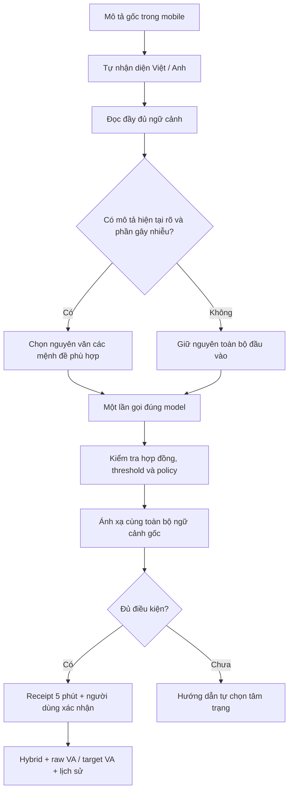

# Tối ưu đầu vào cảm xúc Việt/Anh — 30/10/2026

> Cập nhật tiếp theo: [Hoàn tất tối ưu luồng mobile AI v5 — 31/10/2026](MOBILE_AI_HARDENING_2026-10-31.md). Kết quả bên dưới là snapshot v4 ngày 30/10.

## Kết quả chính

Đã triển khai **`context-mapping-v4`** vào backend local cổng **5170**, dùng các model đang active: PhoBERT `phobert_vsmec_v2` và RoBERTa VA `roberta_va_regression_v2`. Không thay weights, tokenizer, preprocessing của artifact, threshold, policy hay model registry.

Đúng câu trong ảnh:

> Vì tôi đang buồn nên tôi muốn có một bài gì đó giúp làm nổi lên cái buồn của tui. Bạn hiểu mà đúng k?

| Lần xử lý | Đầu vào model | Kết quả |
| --- | --- | --- |
| Trước | Cả đoạn, gồm yêu cầu tìm nhạc và câu hỏi phụ | Enjoyment 39,28%, Sadness 37,87%; không đủ ngưỡng |
| Sau | Nguyên văn phần “Vì tôi đang buồn” | Sadness 87,20%; gợi ý **Buồn**, vẫn yêu cầu xác nhận |

Đây là xác suất softmax của model, **không phải tỷ lệ dự đoán đúng**. Câu chỉ khoảng 101 ký tự: lần lỗi này do nội dung trộn nhiều mục đích làm phân tán kết quả, không phải vượt giới hạn ô nhập.

Đã thử thêm bản tiếng Anh “I am sad so I want a cheerful song to help me feel better. You know what I mean?”: model nhận nguyên văn “I am sad”; API gợi ý Sad bằng đúng RoBERTa VA. Model regression không có confidence phân loại.

## Phạm vi bám đề cương

Phần cập nhật phục vụ chuỗi: **nhập mô tả → nhận diện cảm xúc → ánh xạ mood/V-A → người dùng xác nhận → Hybrid Recommendation → lịch sử**. Hệ thống vẫn kết hợp model thực và quy tắc ngữ cảnh công khai.

Yêu cầu tìm bài hát/phim được tách để không lẫn với cảm xúc hiện tại. Bản này chưa biến cả đoạn thành truy vấn tìm kiếm tự do hoặc cơ chế tự thay mục tiêu cảm xúc: ví dụ “tôi buồn nhưng muốn nhạc vui” xác định trạng thái hiện tại là Buồn; nội dung gợi ý vẫn theo mood mà người dùng xác nhận và bộ lọc hiện có.

## Luồng sau tối ưu



1. **Đọc toàn bộ mô tả trước khi chọn phần đưa vào model.** Không lấy mặc định câu đầu và không lấy từ khóa cảm xúc đầu tiên.
2. **Phân biệt cảm xúc hiện tại với nội dung mong muốn.** Hỗ trợ yêu cầu đứng trước/sau cảm xúc, như “tôi buồn nên tôi muốn…” và “tôi muốn… vì tôi đang buồn”; các cách hỏi gợi ý trực tiếp Việt/Anh được kiểm tra riêng.
3. **Tách bối cảnh không phải cảm xúc hiện tại khi đủ rõ:** chuyện quá khứ đối chiếu hiện tại, cảm xúc người khác, trích dẫn, và cảm xúc riêng đã được phủ định.
4. **Giữ đủ phủ định và điều kiện.** Câu có nhiều cảm xúc mâu thuẫn, giả định, cảm xúc chưa được danh mục hỗ trợ hoặc dấu hiệu mỉa mai vẫn qua guard của cả mô tả; không cắt bỏ phần khó để ép ra kết quả.
5. **Chọn nguyên văn theo vị trí ký tự**, bảo toàn tiếng Việt có dấu, Unicode dạng tổ hợp, apostrophe và thứ tự câu. Không tự viết thành câu mẫu “Tôi vui/buồn” dựa trên nhãn regex.
6. **Một lần inference cho mỗi lượt phân tích.** Không chạy lại nhiều câu rồi chọn score lớn nhất; không thêm LLM hay tải model mới.
7. **Giữ tuyến ngôn ngữ ổn định:** chỉ dùng phần đã chọn khi ngôn ngữ vẫn phù hợp với tuyến model của mô tả. Câu trộn Việt/Anh có thể giữ nguyên toàn văn nếu việc tách sẽ gửi mệnh đề thuần Anh vào model Việt.
8. **Hợp đồng model và threshold giữ nguyên.** Phần rõ bằng quy tắc vẫn không vượt qua ngưỡng model/policy bằng cách tự gán score.
9. **Raw V/A là kết quả thật của đầu vào thực tế đã gửi model.** Target recommendation vẫn được giới hạn trong vùng mood, lưu riêng với raw V/A.
10. **Mobile giữ giao diện ngắn gọn.** Khi thiếu confidence, thông báo “AI chưa đủ chắc chắn. Chọn tâm trạng bên dưới để tiếp tục.”; không bảo người dùng mô tả chưa rõ dù đã nói rõ.

## Provenance và tương thích

- Response bổ sung `inputScope`: `full_text` hoặc `focused_self_description`, cùng `analyzedCharacterCount`.
- Receipt lưu phạm vi, raw V/A, model version, mapping version; **không lưu mô tả gốc hay phần câu đã chọn**.
- Mapping version: `policy|context-mapping-v4|method`. Receipt mapper cũ yêu cầu phân tích lại; không chấp nhận kết quả cũ như kết quả v4.
- Giữ nguyên xác thực, user binding, kiểm tra model đang active, policy/geometry hash, thời hạn receipt, lease và chống gửi lặp.
- MongoDB `aiVaAnalyses` thêm **trường optional** `inputScope`. Startup mở thêm đúng thuộc tính này ở validator cũ; giữ các rule và tùy chọn khác, không viết lại document. Bộ test có kiểm tra upgrade và chạy lặp.
- Các client cũ bỏ qua hai trường response mới vẫn hoạt động. Mobile không hiển thị thêm thông số kỹ thuật.
- Endpoint GoEmotions 28 nhãn độc lập không đổi.

## Kiểm chứng bản cuối

Lượt model thật: **30/10/2026 20:13 (UTC+7)**.

| Hạng mục | Kết quả |
| --- | --- |
| Tập ví dụ hồi quy Việt/Anh chạy model thật | **174 câu**: 90 VI, 84 EN |
| Câu có mood kỳ vọng | 98 |
| Được nhận và khớp kỳ vọng | **93/98**: VI 48/52, EN 45/46 |
| Được nhận nhưng sai mood kỳ vọng | **0 trong tập này** |
| Câu có mood kỳ vọng chưa được nhận | **5**, chi tiết dưới |
| Các ca bắt buộc yêu cầu làm rõ bị nhận nhầm | **0/70** |
| Lượt dùng đầu vào được chọn theo ngữ cảnh | 52 |
| Model thật/API/phạm vi input/receipt/raw-target/Hybrid/history | **1.514 assertions pass** |
| Quy tắc ngữ cảnh/offset/Unicode/yêu cầu/giả định | **328 assertions pass** |
| Backend HTTP/business/receipt/schema compatibility | **1.035 assertions pass** trên MongoDB tạm |
| Mobile | **88 tests pass**, analyzer không có vấn đề |
| Median API local khi model đã nạp | VI 20.37 ms; EN 20.00 ms |
| P95 API local | VI 28.62 ms; EN 27.75 ms |

Số đo trên RTX 3050 Laptop, model đã warm; không đại diện độ trễ mạng/thiết bị thật. Bộ này là ví dụ hồi quy đã dùng để phát triển quy tắc, **không phải gold độc lập hoặc accuracy tổng quát**.

Runner trả exit **2** do còn 5 ví dụ có mood kỳ vọng nhưng trả unknown; các assertion hạ tầng và guard pass. Không báo toàn bộ 174 câu đã đoán đúng và không hạ threshold để đổi mã thoát.

### Các trường hợp còn giữ tự chọn

| ID | Câu kiểm tra | Lý do |
| --- | --- | --- |
| `vi-18` | Tôi đang tập trung cao độ để học và không muốn bị làm phiền. | `low_confidence` |
| `vi-19` | Tôi nhớ tuổi thơ, những ký ức cũ khiến tôi bồi hồi hoài niệm. | `low_confidence` |
| `vi-negation-10` | Tôi không thấy buồn và đang vui | `low_confidence` |
| `en-request-07` | I am not happy so I want a song. | `negation_model_conflict` |
| `vi-request-15` | Tôi đang thư giãn nên tôi muốn nghe nhạc nhẹ. | `low_confidence` |

Bốn câu VI còn dưới ngưỡng model/policy. Câu EN “not happy” không tự đồng nghĩa Sad; model hiện cho bằng chứng V/A chưa đủ phù hợp để xác nhận mood thay thế, nên trả unknown có cơ sở. Không lấy keyword để giả làm kết quả AI.

## Kiểm tra stack chính

Đã Stop/Start qua runner có xác minh tiến trình. Cả hai model Việt/Anh và GoEmotions đang sẵn sàng CUDA; backend 5170 và Admin 5174 đáp ứng.

Smoke trên đúng API đang phục vụ app:

| Ngôn ngữ | Model | Mood | Input scope |
| --- | --- | --- | --- |
| VI | `phobert_vsmec_v2` | Sad / Buồn | `focused_self_description` |
| EN | `roberta_va_regression_v2` | Sad / Buồn | `focused_self_description` |

Hai lượt smoke chỉ phân tích bằng tài khoản đã được cho phép kiểm thử: tạo receipt ngắn hạn và metric tổng hợp; **không gọi Recommendation/ratings và không thêm history trên DB chính**.

Đối chiếu trước/sau: 4 tài khoản, 60 phim, 57 bài hát, 117 contents, 7 mood, 7 đánh giá, 84 history; giữ nguyên số lượng. Validator chỉ thêm phạm vi input; rule cũ giữ nguyên. Không đổi model registry.

## Giới hạn còn lại

- Model học từ dữ liệu có giới hạn; câu phức tạp, mỉa mai ngầm, từ lóng mới và thông tin mơ hồ vẫn có thể cần người dùng xác nhận/tự chọn.
- Bộ tách ngữ cảnh là quy tắc version hóa, không phải một model ngôn ngữ hiểu mọi cuộc hội thoại.
- Hai predictor vẫn tokenize tối đa 128 token; focus chỉ áp dụng khi có đủ bằng chứng ngữ cảnh. Không cắt tùy tiện câu không rõ.
- PhoBERT VSMEC 7 lớp chưa biểu diễn trực tiếp mọi mood của app; chưa retrain.
- Bản export preprocessing gốc của quá trình train vẫn cần được đối chiếu như tài liệu audit trước; bản sửa này không tự thay nó.
- Chưa có Android emulator/điện thoại kết nối khi chốt lượt này: đã kiểm tra Flutter widgets/API, chưa xác nhận thao tác và hiệu năng trên thiết bị Android thật.
- Đánh giá chất lượng độc lập và các yêu cầu quality approval không bị thay thế bởi bộ hồi quy.

## File liên quan và chạy lại

- `backend/Services/SemanticMoodMapper.cs`: ngữ cảnh và chọn nguyên văn đầu vào.
- `backend/Services/BilingualMoodAnalysisService.cs`: gửi một lần tới đúng model, kiểm tra output và cấp receipt.
- `backend/Services/VaAnalysisReceipt.cs`, `backend/Data/MongoStore.cs`, `backend/Data/mongo-schema.json`: provenance/compatibility.
- `mobile-app/lib/screens/mood_discovery_screen.dart`: hướng dẫn rõ khi model thiếu tin cậy.
- `tests/SemanticMoodMapperTests.cs`, `tests/BilingualAnalysisTests.cs`, `tests/BilingualMoodDiagnostics.cs`, `tests/ai-cases/bilingual-flow-cases.json`: test ngữ cảnh, hợp đồng và model thật.

```powershell
dotnet build tests\Moodify.Integration.csproj --artifacts-path .local-build\mood-input-focus
$env:MOODIFY_TEST_ROOT = (Get-Location).Path
$env:MOODIFY_BACKEND_DLL = Join-Path $env:MOODIFY_TEST_ROOT '.local-build\mood-input-focus\bin\mood_recommendation\debug\mood_recommendation.dll'
dotnet .local-build\mood-input-focus\bin\Moodify.Integration\debug\Moodify.Integration.dll --mood-context-contract
dotnet .local-build\mood-input-focus\bin\Moodify.Integration\debug\Moodify.Integration.dll
# Cần hai model local sẵn sàng trước lệnh sau:
dotnet .local-build\mood-input-focus\bin\Moodify.Integration\debug\Moodify.Integration.dll --bilingual-full-audit
```

Kết quả local không đưa lên Git: `.local-build/bilingual-mood-diagnostic-20261030T131317Z/results.json`, `mood-input-real-final.log`, `mood-input-backend-final.log`, `mood-input-flutter-final.log`, `mood-input-analyzer-final.log`, `mood-input-main-smoke.json`, snapshot số lượng/validator trước-sau. Bản sao source trước sửa trong `.local-backups/mood-input-focus-*`.
