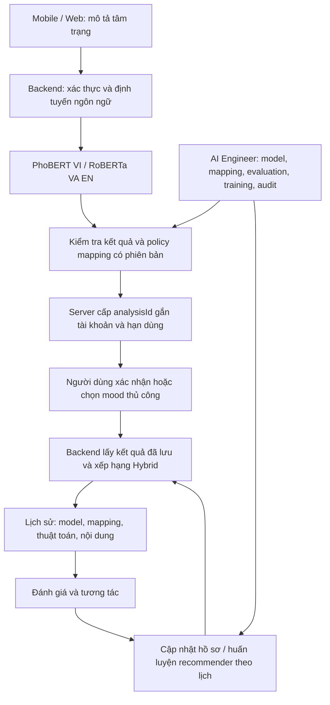

# Kế hoạch thống nhất AI cho Moodify

Ngày lập: **26/10/2026**. Cập nhật: **27/10/2026**. Trạng thái: **Đã triển khai phần kỹ thuật P0–P8 trong phạm vi hiện tại, gồm quality gate NLP và E2E Android/Web với model thật. P3/P5 và phần đánh giá thực nghiệm P6 còn phụ thuộc preprocessing/gold/rating thật; chưa nghiệm thu chất lượng toàn bộ. RL/bandit được người dùng loại khỏi phạm vi bắt buộc, pilot tiếp tục tắt.**

Bằng chứng, hợp đồng hiện hành, kết quả model thật và giới hạn: [AI_SYSTEM_UNIFICATION_RESULTS.md](AI_SYSTEM_UNIFICATION_RESULTS.md). Checkbox phản ánh đúng phạm vi có bằng chứng, không phải toàn bộ đề cương đã hoàn thành.

Mục tiêu: thống nhất Mobile, Web người dùng, backend, Python inference, database và dashboard AI Engineer; đối chiếu đúng đề cương CNTT-KLCN318. Tài liệu này giữ thứ tự triển khai và checklist; báo cáo kết quả được tách ở liên kết trên.

## 1. Giữ lại và hiểu đúng hệ thống hiện tại

| Thành phần | Hiện trạng đã đối chiếu |
| --- | --- |
| PhoBERT tiếng Việt | Phân loại 7 cảm xúc VSMEC; V/A được quy đổi bằng trung bình xác suất trên các điểm neo cố định. |
| RoBERTa VA tiếng Anh | Dự đoán trực tiếp V/A bằng regression. |
| Phiên bản model | Lượt kiểm tra gần nhất: `phobert_vsmec_v2`, `roberta_va_regression_v2`, runtime CUDA ready. Phải đọc lại trạng thái khi bắt đầu làm. |
| GoEmotions 28 nhãn | Classifier và mapping cũ vẫn là luồng riêng; không phải mapping đang quyết định kết quả hai model song ngữ trên Mobile. |
| Mobile | Tự nhận diện Việt/Anh bằng quy tắc nhẹ; gọi `/api/MoodAnalysis/valence-arousal`, người dùng xác nhận rồi nhận gợi ý. |
| Recommender | Mood Matching + Content-based + CF theo người dùng tương tự; trọng số hiện tại 55%/30%/15%, chuẩn hóa lại khi thiếu thành phần. Đã có MF offline/registry/serving với fallback; chưa Activate MF trên DB chính do dữ liệu ít. |
| Feedback | Sao và tương tác cập nhật hồ sơ/thứ hạng ở yêu cầu sau. Đã có contextual bandit thử nghiệm, mặc định tắt; không gọi là RL nhiều bước. |
| Đề cương | Ghi BERT/DistilBERT–GoEmotions, CF/Matrix Factorization, Hybrid và RL. Phải giải trình phương pháp/model/dataset thực tế, không ghi đã đạt toàn bộ chỉ vì app chạy được. |

**Giữ hai model làm nền tảng.** Quyết định train lại dựa trên đánh giá, không dựa vào tên model hoặc vài câu demo. Hai model NLP không thay thế mô hình gợi ý.

Giữ các luồng đã làm: tài khoản/Google/quên mật khẩu, thông báo, AI tự nhận ngôn ngữ, quiz, thư viện, lịch sử, đánh giá, thống kê, Spotify/YouTube, giao diện, splash và icon chung.

## 2. Luồng đích cần thống nhất

Cùng văn bản, ngôn ngữ, model, mapping và dữ liệu phải cho kết quả nhất quán giữa các client. Client không tự quyết định kết quả AI có nguồn gốc hợp lệ.

## 3. Thứ tự thực hiện

### P0 — Chốt baseline và bảo toàn dữ liệu

**Bằng chứng 27/10:** workspace/HEAD được ghi nhận; backup 21 collection/456 bản ghi đã restore round-trip, có checksum artifact/cấu hình và bảng đối chiếu đề cương. MongoDB chính không đổi.

- [x] Xác nhận đúng workspace `D:\hoc-tap\moodify-project`, nhánh Git và thay đổi chưa commit.
- [x] Kiểm kê các nơi gọi AI, model đang serving, registry/marker, mapping, schema và cấu hình thực tế.
- [x] Sao lưu MongoDB mới nhất, cấu hình và artifact manifest/checksum; không sao chép weights lớn nếu không cần.
- [x] Ghi baseline các thuật toán và bộ kiểm thử hiện có. Dùng DB `moodify_test_*` riêng khi thử ghi.
- [x] Lập bảng yêu cầu đề cương ↔ tính năng/model/dataset hiện dùng ↔ bằng chứng ↔ phần thiếu.

**Hoàn thành khi:** có snapshot tái lập được, phân biệt source/config/runtime và trạng thái được xác minh.

### P1 — Chuẩn hóa hợp đồng và điều khiển AI

**Bằng chứng 27/10:** hợp đồng chung, backend auto routing, trạng thái từ chối, cờ AI/timeout đã có test VI/EN; Mobile/Web dùng cùng hợp đồng. Xem báo cáo kết quả.

- [x] Dùng chung hợp đồng cho VI/EN: trạng thái, ngôn ngữ, loại model, phiên bản, V/A, mood, nguồn và phiên bản mapping.
- [x] Phân biệt `matched`, chưa đủ tin cậy, ngôn ngữ không hỗ trợ, runtime lỗi/bận. Không trả `matched` khi kết quả không được chấp nhận.
- [x] Confidence chỉ xuất khi có ý nghĩa phân loại; không tạo confidence giả cho regression hoặc coi confidence là accuracy.
- [x] Đưa logic định tuyến dùng chung về backend. Giữ Mobile mặc định tự nhận Việt/Anh và dòng nhỏ thông báo model, không đưa lại bộ chọn ngôn ngữ.
- [x] Có quy tắc rõ cho câu không dấu, câu ngắn, emoji và câu pha ngôn ngữ; không âm thầm chọn model khác khi model cần dùng bị lỗi.
- [x] Áp dụng cờ bật/tắt AI thống nhất. Hiện nhánh EN kiểm tra `AI:Enabled`, nhánh VI cần bổ sung kiểm soát tương ứng.
- [x] Đồng bộ timeout, xử lý busy/503 và thông báo thử lại; giữ chọn mood thủ công làm đường sử dụng tiếp.

**Hoàn thành khi:** bật/tắt AI và lỗi model được xử lý đúng trên cả VI/EN, Mobile/Web; hợp đồng có kiểm thử chung.

### P2 — Server quản lý kết quả phân tích và xác nhận

**Bằng chứng 27/10:** receipt MongoDB TTL 5 phút + lease; dùng V/A server, kiểm tra user/expiry/model/policy/vùng mood, manual override, replay sau restart và test giả mạo/gửi trùng.

- [x] Lưu kết quả đã xác minh ở server; trả `analysisId` ngẫu nhiên, gắn user, thời điểm/hạn dùng, ngôn ngữ, model và mapping.
- [x] Khi nhận yêu cầu gợi ý AI, backend dùng V/A và phiên bản đã lưu; không tin V/A/modelVersion do client tự gửi.
- [x] Kiểm tra kết quả được chấp nhận, quyền sở hữu, hạn dùng, cấu hình mood/mapping và trạng thái model theo policy đã công bố.
- [x] Định nghĩa rõ xác nhận mood AI và chọn lại thủ công. Thao tác thủ công phải lưu nguồn manual, không giả nguồn AI.
- [x] Thêm idempotency: gửi lại cùng yêu cầu không nhân đôi lịch sử; thay tham số phải được xử lý rõ ràng.
- [x] Lưu provenance đủ để truy nguyên, không ghi JWT/credential vào log; hạn chế lưu văn bản tâm trạng thô và xác định thời hạn nếu cần lưu.

**Hoàn thành khi:** sửa V/A/phiên bản, dùng analysis của người khác, hết hạn, kết quả dưới ngưỡng và submit trùng đều được kiểm soát bằng test API.

### P3 — Đánh giá và xử lý điểm yếu PhoBERT → V/A

**Tiến độ 27/10:** đã chứng minh giới hạn neo, tách policy version và chạy baseline 26 câu với hai model thật. Chọn giữ model có giới hạn khi chưa có gold VA mới. Đã tìm archive/18 thư mục Drive, đọc log notebook và đối chiếu CSV; chưa khôi phục đúng từ điển gốc. Xem [audit preprocessing](PHOBERT_PREPROCESSING_AUDIT.md); JSON mới là ứng viên, 670 ca chỉ chứng minh parity thuật toán khi dùng cùng từ điển.

**Phát hiện đã chứng minh từ code:** mọi điểm neo hiện tại thỏa `A >= 0.75 × V`. Trung bình theo xác suất cũng thỏa điều kiện này, nên không thể biểu diễn vùng `V > 0, A < 0` — tích cực nhưng ít năng lượng.

- [x] Ghi lại hạn chế này trong đánh giá kỹ thuật, không che bằng cách đổi tên mood.
- [ ] Kiểm tra preprocessing có khớp lúc train: emoji, teencode, tách từ, thứ tự nhãn, độ dài và threshold.
- [x] Tách phiên bản model phân loại khỏi phiên bản phương pháp suy ra V/A.
- [x] Chạy baseline trước khi sửa; đánh giá riêng câu thư giãn/bình yên, tập trung, hoài niệm, lãng mạn, phủ định và cảm xúc pha trộn.
- [x] Chọn phương án dựa trên dữ liệu:
  - **Có nhãn V/A tiếng Việt:** cân nhắc regression hoặc multi-task head, train/calibrate riêng.
  - **Có bộ nhãn mood phù hợp:** đánh giá classifier/adapter học từ dữ liệu cho các mood đích.
  - **Chưa có nhãn phù hợp:** giữ bản hiện tại ở mức giới hạn đã công bố, hỗ trợ xác nhận/chọn tay và chuẩn bị dữ liệu.
- [ ] Nếu dùng mapping/rule bổ sung, phải có nguồn, phiên bản và đánh giá; không gọi là năng lực model tự học.
- [ ] Chỉ thay serving khi candidate đạt tiêu chí đã chốt trên validation và vượt kiểm tra độc lập.

**Hoàn thành khi:** có kết quả đo trước/sau và quyết định có căn cứ. Không coi việc chỉnh vài điểm neo để “ra đủ mood” là hoàn thành chất lượng.

### P4 — Đồng bộ dashboard, mapping và database

**Tiến độ 27/10:** overview/lab và phạm vi GoEmotions đã đồng bộ; đã kiểm kê mood/catalog/review status. Đã có policy song ngữ revision/audit, schema/job/report riêng VSMEC7/VA/MF, runner thực thi offline, lifecycle validate/activate/deactivate/rollback và metrics theo ngày/model/policy. Đã nối quality gate vào các API kích hoạt/rollback VI/VA; upload chỉ lưu candidate. Gate đối chiếu policy, report đã review và fingerprint; server không tự chứng minh tính độc lập của nhãn hoặc tính lại mọi metric từ dự đoán.

- [x] AI overview/Inference lab hiển thị và kiểm thử đúng hai pipeline đang dùng; phân biệt classifier GoEmotions cũ.
- [x] Định tuyến model → loại đầu ra → mapping/VA policy tương ứng; UI không cho hiểu rằng mapping 28 nhãn điều khiển PhoBERT hoặc VA regression.
- [x] Quản lý mapping theo ID mood ổn định, có version/revision, kiểm tra dữ liệu, audit và xử lý đổi/xóa mood.
- [x] Kiểm kê vùng V/A của mood và tọa độ phim/nhạc; rà soát dữ liệu thiếu, nguồn gán nhãn và trạng thái reviewed.
- [x] Tách VA model dự đoán, VA nội dung và VA vùng mood; không sửa VA nội dung hàng loạt chỉ để tăng độ phủ.
- [x] Giữ phân quyền: Admin quản lý catalog/người dùng; AI Engineer quản lý model/policy/evaluation/training; phần chung áp dụng cùng quyền API.
- [x] Đồng bộ Datasets/Evaluation/Training jobs theo loại model: 28 nhãn GoEmotions, 7 nhãn VSMEC, VA regression và recommender có schema/metric riêng.
- [x] Kiểm tra validate/activate/deactivate/rollback, restart và active marker cho từng model; thử rollback giữa hai artifact khác nhau trên môi trường tạm.
- [x] Bổ sung quality policy bất biến trước evaluation job; chặn activate/rollback candidate thiếu approval khớp artifact/runtime. Có aggregate latency/status/accepted theo phiên bản; chưa có hệ thống cảnh báo production theo tải thực.

**Hoàn thành khi:** một thay đổi mapping/model có tác dụng rõ ở pipeline tương ứng và truy nguyên được trên app/history/dashboard.

### P5 — Đánh giá độc lập hai model NLP

**Tiến độ 27/10:** 20 ca gốc + 6 ca bổ sung đã chạy thật, có latency/model/device và artifact manifest. Có evaluator offline, evaluation-only runner và [protocol gán nhãn/đánh giá](AI_EVALUATION_PROTOCOL.md). Đã chuẩn bị [công cụ/hướng dẫn gán nhãn offline](HUONG_DAN_GAN_NHAN_AI.md), mẫu 48 câu chưa review; chưa có gold set độc lập mới, chưa công bố metric chất lượng serving. Kết quả cũ trong notebook là bằng chứng lịch sử, không đại diện preprocessing đang phục vụ.

- [x] Dùng 20 ca trong `AI_MODEL_TEST_CASES.md` làm smoke chức năng; cập nhật phiên bản theo runtime.
- [ ] Chuẩn bị tập đánh giá Việt/Anh độc lập lớn hơn, bao phủ câu đời thường, phủ định, pha cảm xúc, emoji và các mood ứng dụng.
- [ ] Phân biệt nhãn cảm xúc, nhãn mood và nhãn V/A; ghi cách gán nhãn/rà soát, bất đồng và phạm vi dữ liệu.
- [ ] Tách train/validation/test, chống trùng và leakage; chốt threshold trên validation trước khi xem test.
- [ ] PhoBERT: macro-F1, confusion matrix; nếu từ chối dưới ngưỡng thì báo thêm coverage và độ đúng trên phần được chấp nhận.
- [ ] RoBERTa/adapter V/A: MAE/RMSE, tương quan và sai số theo vùng; không tạo accuracy phân loại từ điểm regression.
- [ ] Đánh giá thêm bước V/A → mood và hiệu quả gợi ý cuối cùng. Giữ test riêng cho câu hai ngôn ngữ tương đương; không bắt buộc hai model trả V/A giống hệt.
- [x] Ghi thời gian phản hồi, thiết bị, model/config hash và các ca sai. Không coi runtime ready hoặc test phần mềm pass là bằng chứng chất lượng.

**Hoàn thành khi:** có báo cáo tái lập được, baseline và giới hạn; đủ căn cứ quyết định giữ/calibrate/train thêm từng model.

### P6 — Bổ sung Matrix Factorization và hoàn thiện Hybrid

**Tiến độ 27/10:** MF biased-SGD train thật offline, temporal splits, registry/gate/CAS/rollback và đường phục vụ Hybrid đã được test trên dữ liệu tổng hợp/DB tạm. Có `evaluate_hybrid.py` chọn trọng số bằng validation, so baseline/test, coverage/diversity/cold context. Chưa calibrate bằng dữ liệu ứng dụng đủ lớn; main DB chỉ 7 rating và MF vẫn chưa active. Hai checkbox đo/tối ưu bên dưới chưa đạt nghiệm thu chất lượng thật.

- [x] Giữ Mood Matching, Content-based và user-neighbor CF hiện tại làm baseline.
- [x] Chốt dữ liệu user–item: rating mới nhất, tín hiệu tương tác yếu, nội dung xóa và ID catalog ổn định.
- [x] Tách train/validation/test theo thời gian; không dùng phản hồi tương lai để gợi ý quá khứ.
- [x] Xây dựng MF có regularization, seed, cấu hình và artifact có version; chọn phương pháp phù hợp loại phản hồi và lượng dữ liệu.
- [x] Huấn luyện offline, không train trong request Mobile. Giữ fallback khi user/item mới hoặc artifact không sẵn sàng.
- [ ] Kết hợp điểm MF, nội dung và mood; hiệu chỉnh/chuẩn hóa điểm và trọng số bằng validation.
- [ ] Đo Precision/Recall/NDCG@K phù hợp dữ liệu, coverage/diversity và tác động cold start; so sánh với baseline.
- [x] Giữ giải thích gợi ý và phân biệt điểm tổng hợp, độ gần mood, confidence NLP. “Mức phù hợp 100%” không phải xác suất người dùng thích.

**Hoàn thành khi:** MF chạy thật qua đường gợi ý và có kết quả so sánh; nếu dữ liệu ít, ghi rõ chưa đủ bằng chứng vượt baseline.

### P7 — Feedback Loop và quyết định phạm vi RL

**Phạm vi người dùng đã chốt ngày 27/10:** RL/bandit không bắt buộc trong lượt này; giữ feedback loop, không bật pilot. Không coi đây là GVHD đã sửa đề cương. Các checkbox nghiên cứu RL phía dưới là phạm vi gốc còn để tham khảo, không chặn hoàn thiện code hiện tại.

**Tiến độ 27/10:** đã kiểm tra rating qua API làm đổi profile/ranking ở yêu cầu sau, dislike thắng mở link. Có contextual epsilon-greedy bandit với mood context, ba arm Hybrid, propensity và nhóm account ổn định; mặc định tắt. Có report/pilot rollback, nhưng chưa có nghiên cứu A/B với người dùng thật và chưa có quyết định GVHD rằng bandit đáp ứng yêu cầu RL nhiều bước. Retrain MF hiện là job offline do người vận hành chủ động, không có lịch tự động.

- [x] Xác nhận rating/tương tác ảnh hưởng được đến lần gợi ý sau; dislike mạnh hơn mở link, không tính một lần mở là đã nghe/xem hết.
- [x] Chốt cách cập nhật hồ sơ, tái huấn luyện, cache invalidation và version chiến lược.
- [x] Tách bảng đánh giá nội dung khỏi nhãn huấn luyện cảm xúc; không tự biến nhận xét/sao thành nhãn NLP.
- [ ] Đối chiếu yêu cầu RL với GVHD:
  - Nếu giữ yêu cầu RL: thiết kế state/context, action, reward, policy, exploration, log exposure/propensity và quy trình đánh giá.
  - Nếu chọn contextual bandit: mô tả đúng phạm vi, thống nhất cách đáp ứng yêu cầu; không gọi là full RL nhiều bước.
  - Nếu được điều chỉnh thành feedback loop: cập nhật tài liệu chính thức và ghi đúng phần đã triển khai.
- [ ] Trước khi thử policy mới: đánh giá offline, có baseline/rollback và giới hạn thử nghiệm. A/B cần chia nhóm ổn định, log phiên bản và tiêu chí đo trước.

**Hoàn thành khi:** chứng minh cơ chế học/cập nhật thực tế; không đổi tên bộ trọng số cố định thành RL.

### P8 — Kiểm thử E2E, hiệu năng và tài liệu

**Tiến độ 27/10:** đã kiểm tra API/model thật trên DB tạm, cùng VA cho cùng ranking, quyền/provenance, hồi quy phần mềm và cập nhật tài liệu. Đã chạy emulator Android người dùng mở: đăng nhập → model VI/EN thật → xác nhận → Hybrid → chi tiết → đánh giá → lịch sử; app thử có package riêng và DB tạm. Đã đo debug UI/cold-start/latency/GPU/RAM server, burst 4 request và kiểm tra trình duyệt; phạm vi/bằng chứng cuối cùng nằm ở báo cáo kết quả, không gọi burst nhỏ là capacity benchmark.

- [x] Kiểm thử thật Mobile/Web → backend → đúng model → xác nhận → Hybrid → chi tiết → đánh giá → lịch sử. Android/Web dùng database tạm; không kiểm chứng playback/FCM/email bên thứ ba bằng test AI này.
- [x] Bao phủ AI tắt, model lỗi/bận, tiếng Việt không dấu, confidence thấp, mood thay đổi và request đến muộn.
- [x] So sánh mood thủ công và AI cùng V/A/cùng profile: chênh lệch ranking phải giải thích được.
- [x] Kiểm tra quyền tài khoản và snapshot khi nội dung/model/mapping thay đổi.
- [x] Đo E2E UI trên emulator/debug và warm/cold inference, lấy mẫu GPU/RAM server. Công bố rõ debug chưa đại diện profile/release hoặc điện thoại thật; không gọi các số đo là SLA.
- [x] Giữ kiểm tra hồi quy tài khoản, Google, thông báo, player, đánh giá, thống kê, splash và icon.
- [x] Cập nhật README, hướng dẫn AI Engineer, test cases và sơ đồ kiến trúc theo cùng hợp đồng/modelVersion.
- [x] Báo cáo tách rõ code đã làm, kết quả đo, khó khăn và chưa thực hiện; không sửa báo cáo tuần cũ thành lịch sử mới.
- [ ] Giải trình model/dataset khác đề cương với GVHD; đây là nghiệm thu học thuật bên ngoài phần mềm.

**Hoàn thành khi:** có bằng chứng luồng thật, báo cáo chất lượng riêng, hướng dẫn chạy/khôi phục và danh sách giới hạn trung thực.

## 4. Cách tiếp tục triển khai

Các phase chỉ mô tả phụ thuộc, không phải lý do dừng giữa công việc đã được giao. Đã tiếp tục P4/P6/P7 trong cùng đợt ngày 27/10, không đợi phê duyệt lại các thay đổi code có thể kiểm thử an toàn.

Phần phụ thuộc dữ liệu/đánh giá ngoài code phải để trạng thái thật: chưa có từ điển train gốc/gold mới đã review thì không đổi serving hoặc nhận đã cải thiện chất lượng. Không tự gán nhãn bằng output model để hoàn thành checkbox.

## 5. File trọng tâm

| Phần | File/thư mục cần kiểm tra |
| --- | --- |
| Mobile | `mobile-app/lib/core/api_service.dart`, `screens/mood_discovery_screen.dart`, `services/mood_analysis/` |
| Hợp đồng AI | `backend/Controllers/MoodAnalysisController.cs`, `Services/ValenceArousalAnalysisService.cs`, `Services/VietnameseEmotionService.cs` |
| Provenance/gợi ý | `backend/Controllers/RecommendationController.cs`, `Services/MoodAnalysisService.cs`, `DTOs/ManagementDtos.cs` |
| Recommender | `backend/Services/HybridRecommender.cs`, `Services/MoodScoring.cs` |
| Inference | `ai-service/main.py`, `vietnamese_predictor.py`, `va_predictor.py`, `predictor.py` |
| Dashboard/training | `admin-web/src/ai-workspace.js`, controller/service AI workspace trong backend, `ai-service/train_worker.py` |
| Dữ liệu/kiểm thử | schema MongoDB, `tests/`, `mobile-app/test/`, `docs/AI_MODEL_TEST_CASES.md` |

## 6. Nguyên tắc thực hiện

- Người dùng đã yêu cầu thực hiện ngày 27/10/2026. Phần đã làm được đánh dấu và dẫn bằng chứng; phần chưa đạt nghiệm thu vẫn để trống.
- Dùng đúng workspace hiện tại; không tạo bản project khác, reset Git hoặc ghi đè thay đổi đang có.
- Không xóa model/dataset/archive và không tự thay artifact serving trước khi đánh giá candidate.
- Không train trên dữ liệu riêng tư hoặc chỉnh DB chính để làm đẹp kết quả. Snapshot thực tế phải ghi rõ thời điểm.
- Kiểm thử ghi trên database tạm; thao tác live phải phục vụ nhu cầu đã được giao, có backup và cách khôi phục.
- Cấu hình/secret/weights giữ ngoài Git theo cơ chế hiện có; không log raw token hoặc private key.
- Giữ model active độc lập với trạng thái runtime; giữ training độc lập với serving.
- Checkbox chỉ được đánh dấu khi có code/kết quả kiểm chứng; không lấy kế hoạch, UI nút bấm hoặc mock test làm bằng chứng đã chạy model thật.

## 7. Phần còn lại thực sự cần làm

1. **Anh gán/review nhãn:** mở `tools/ai-label-review.html`, nhập `docs/ai-evaluation/review-starter.json`; làm theo [hướng dẫn](HUONG_DAN_GAN_NHAN_AI.md). Mẫu 48 câu chỉ tập quy trình, không tự đủ nghiệm thu.
2. **P3/P5:** khôi phục preprocessing đúng lần train hoặc đánh giá candidate mới bằng gold độc lập. Chạy evaluation-only, review baseline/validation/test rồi mới xin approval; code gate đã có, chưa có kết quả chất lượng thật để approve.
3. **P6:** thu rating thật theo thời gian, bổ sung dữ liệu đủ để đánh giá MF và calibrate Hybrid. Không Activate fixture hoặc đổi trọng số production để hoàn thành checklist.
4. **P8 nâng mức bằng chứng:** đo profile/release và điện thoại thật nếu cần kết luận độ mượt production. Android emulator/debug E2E đã pass; không cần coi thiếu emulator là blocker nữa.
5. **Vận hành dài hạn:** scheduler retrain, retention và cảnh báo tải thực khi có nhu cầu/dữ liệu. Hiện retrain chủ động; không tự train/promote trong request.
6. **Đề cương:** giải trình model/dataset và phạm vi RL với GVHD. RL/bandit không bắt buộc theo chỉ đạo người dùng hiện tại; giữ pilot off.

Đọc [kết quả hiện hành, mục 16–18](AI_SYSTEM_UNIFICATION_RESULTS.md), [audit preprocessing](PHOBERT_PREPROCESSING_AUDIT.md), [protocol](AI_EVALUATION_PROTOCOL.md) và [hướng dẫn nhãn](HUONG_DAN_GAN_NHAN_AI.md). Không commit/push trong lượt này.
