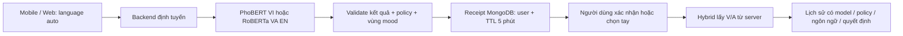

# Kết quả thống nhất AI — 27/10/2026

## 1. Phạm vi đã hoàn thành

**Trạng thái mới nhất:** đã triển khai phần kỹ thuật, quality gate cho hai model và E2E Android/Web với model thật. **Chưa nghiệm thu chất lượng toàn bộ P0–P8:** thiếu preprocessing train gốc/gold độc lập và dữ liệu ranking đủ lớn. RL/bandit không bắt buộc theo chỉ đạo người dùng hiện tại, tiếp tục tắt. **Mục 16–19 là kết quả mới nhất**; mục 2–15 giữ bằng chứng từng đợt, các dòng “chưa Android/chưa gate” ở đó phản ánh thời điểm trước khi bổ sung.

Workspace: `D:\hoc-tap\moodify-project`, nhánh `Phuong`, HEAD đầu phiên `0e42360`. Working tree sạch lúc bắt đầu. Không commit/push/reset Git trong lượt này.

Giữ nguyên weights, ngưỡng confidence, điểm neo V/A và active marker của hai model. Không huấn luyện hoặc activate model mới trên môi trường chính. Phần tiếp tục có train fixture và activate/rollback model/chiến lược trong môi trường tạm để chứng minh code thực thi. Backend/AI/Admin không chạy ở các cổng 5170/8001/5174 khi bắt đầu. Các tiến trình phục vụ smoke được tạo riêng rồi dừng; trạng thái vận hành cuối cùng được cập nhật ở mục 18.

## 2. Đối chiếu đề cương và hiện trạng

Đã đọc lại đề cương `5_CNTT-KLCN318_Gợi ý phim_nhạc theo tâm trạng_UngDung.docx.md`.

| Yêu cầu | Hiện trạng có bằng chứng | Phần chưa đáp ứng |
| --- | --- | --- |
| Nhập văn bản → phân tích tâm trạng → gợi ý | Mobile/Web dùng cùng endpoint; backend tự chọn PhoBERT VI / RoBERTa VA EN; model thật đã chạy qua Hybrid/lịch sử trên DB tạm | Đánh giá chất lượng độc lập và điện thoại thật; emulator Android đã pass ở mục 16 |
| NLP fine-tune BERT/DistilBERT trên GoEmotions | Classifier GoEmotions 28 nhãn vẫn là pipeline riêng; app đang dùng PhoBERT/VSMEC và RoBERTa VA | Cần giải trình đúng model/dataset/phương pháp thực tế với GVHD |
| Mood + Content-based + Collaborative/Hybrid | Giữ `HybridRecommender`: mood 0.55, content 0.30, CF người dùng tương tự 0.15, chuẩn hóa khi thiếu thành phần | Đã có MF train/registry/serving; chưa có dữ liệu đủ lớn để chứng minh trọng số tối ưu |
| Học từ phản hồi/RL | Rating/tương tác được dùng trong hồ sơ và ranking hiện có | Có contextual bandit thử nghiệm tắt mặc định; chưa có online A/B thật hoặc nghiệm thu RL nhiều bước |
| Dashboard kỹ sư quản lý model/training | Có model lifecycle, pipeline cũ, job local/Colab; overview và lab đã phản ánh luồng song ngữ | Đã thêm schema/job/runner riêng; gate triển khai đã bổ sung; còn bằng chứng NLP chất lượng độc lập |
| Lịch sử, đánh giá, thống kê, tài khoản, player, thông báo | Giữ các chức năng; regression Flutter/backend pass | Không lấy unit test làm bằng chứng đã gửi email/FCM hoặc nghe/xem thật trên máy người dùng |

## 3. Hợp đồng song ngữ mới



`POST /api/MoodAnalysis/valence-arousal`, cần đăng nhập:

```json
{"text":"Hôm nay tôi cảm thấy vui.","language":"auto"}
```

Response dùng chung: `status`, `source=ai_va`, `language`, `modelType`, `modelVersion`, `mappingVersion`, `routingVersion`, `scoreType`, `accepted`, `requiresConfirmation`, `analysisId`, `expiresAt`, V/A, mood và candidates.

- VI: `modelType=emotion_classification_va_adapter`, `scoreType=softmax_not_accuracy`; có nhãn và confidence phân loại.
- EN: `modelType=valence_arousal_regression`, `scoreType=regression_coordinates`; **không tạo confidence phân loại**.
- Đủ điều kiện: `status=matched`, `accepted=true`, mood và receipt có hạn dùng.
- Dưới ngưỡng hoặc văn bản không xử lý được: `status=unknown`, `accepted=false`, `mood=null`, `analysisId=null`.
- Chữ thuộc hệ không hỗ trợ khi tự nhận diện: `unsupported_language`, không gọi model khác để đoán tiếp.
- Runtime lỗi/bận/timeout/AI tắt: HTTP 503, `status=unavailable`, `reasonCode` cụ thể và hướng chọn mood thủ công.

`AI:Enabled` được áp dụng cho cả hai nhánh và việc dùng receipt. Inference chung có timeout 15 giây, ngắn hơn timeout request Mobile 20 giây. Client tải/activate model vẫn có deadline riêng; không dùng thời gian nạp model làm thời gian chờ của mỗi câu.

Quy tắc `vi-en-heuristic-v1`: dấu Việt ưu tiên VI; câu không dấu dùng điểm từ; emoji ưu tiên VI; Latin không có bằng chứng Việt mặc định EN; chữ thuộc hệ khác từ chối. Đây là heuristic có giới hạn với tên riêng, từ mượn, câu ngắn và pha ngôn ngữ. Không tự chuyển sang model ngôn ngữ còn lại khi runtime đã chọn bị lỗi. API còn nhận `vi/en` để tương thích client gọi chủ động; Mobile/Web chính dùng `auto`.

## 4. Xác nhận do server quản lý

Client lấy `analysisId` thật từ response rồi gửi:

```json
{
  "tamTrangID": 1,
  "source": "ai_va",
  "analysisId": "va_0123456789abcdef0123456789abcdef",
  "mode": "hybrid",
  "limit": 12
}
```

ID trên chỉ minh họa định dạng. Backend không chấp nhận ID chưa được cấp.

- V/A, ngôn ngữ, modelVersion và mappingVersion được lấy từ receipt, không lấy từ client.
- Gửi V/A hoặc modelVersion kèm xác nhận song ngữ trả HTTP 400; mã/tài khoản/hạn dùng/model/vùng mood không còn hợp lệ trả HTTP 409.
- Receipt lưu ở `aiVaAnalyses`, có TTL index và kiểm tra hạn dùng trong code; TTL monitor xóa chậm không làm mã hết hạn dùng được.
- Receipt gắn tài khoản, mood đã gợi ý, fingerprint toàn bộ vùng mood, policy và routing version.
- Xác nhận kiểm tra model hiện phục vụ vẫn cùng phiên bản qua readiness. Runtime không sẵn sàng hoặc đổi phiên bản thì yêu cầu phân tích lại.
- Lease MongoDB ngăn hai tác vụ cùng giữ một mã. Unique index lịch sử ngăn nhân đôi nếu có đua ghi.
- Cùng mã + cùng tham số + còn hiệu lực trả cùng `recommendationId`; khác bộ lọc/limit/mode/nguồn/mood trả conflict. Replay và receipt chưa dùng vẫn hoạt động sau backend restart.
- Nếu tác vụ dừng bất thường, lease hết hạn sau 2 phút; retry có thể xử lý lại nếu receipt còn hiệu lực. Dispose chỉ giải phóng lease có đúng ID.
- Chọn lại thủ công gửi `source=manual`; có thể giữ receipt để truy nguyên, nhưng ranking dùng tâm vùng mood được chọn. Không ghi nhận lựa chọn này là quyết định AI.
- Một receipt chỉ dành cho một lần quyết định và bộ tham số chuẩn. Đổi bộ lọc trong Mobile yêu cầu phân tích lại hoặc chọn tay.
- Không lưu văn bản tâm trạng thô/JWT/credential trong receipt. Receipt hết hạn sau 5 phút; lịch sử giữ snapshot/provenance theo chức năng hiện có, không bị TTL receipt xóa theo.

Lịch sử bổ sung `analysisLanguage`, `analysisModelType`, `routingVersion`, `analysisValence`, `analysisArousal`; giữ các trường analysis/model/mapping/decision và snapshot nội dung đã có. Pipeline GoEmotions cũ được giữ tương thích, tách khỏi receipt song ngữ có tiền tố `va_`.

File trọng tâm: `BilingualMoodAnalysisService.cs`, `MoodLanguageRouter.cs`, `VaAnalysisReceipt.cs`, hai controller phân tích/gợi ý, `MongoStore.cs`, schema MongoDB và parser/API Mobile.

## 5. Dashboard và client

- AI overview có runtime/phiên bản riêng cho VI và EN, cờ AI của app, loại đầu ra, policy, vùng mood và giới hạn.
- Inference lab gọi cùng API song ngữ của app; chỉ phân tích/hiển thị, không tự tạo gợi ý hoặc lịch sử. Nó vẫn cấp receipt ngắn hạn của tài khoản kỹ sư như API app.
- Tab **GoEmotions mapping** nói rõ chỉ điều khiển classifier 28 nhãn; chú thích và tiêu đề được giữ sau thao tác duyệt/lưu.
- Dataset/Training jobs hiện được ghi rõ là pipeline GoEmotions/ASL 28 nhãn. Chưa gọi các job đó là huấn luyện PhoBERT hoặc VA regression.
- Endpoint `GET /api/AiWorkspace/pipelines` chỉ AIEngineer được dùng; kiểm thử User/Admin bị từ chối. Không đổi quyền CRUD catalog/người dùng.
- Mobile tự nhận ngôn ngữ tại backend. Dòng trước phân tích ghi **Dự kiến**; sau phân tích ghi model của ngôn ngữ server trả. Không đưa lại bộ chọn ngôn ngữ.
- Mobile bỏ phản hồi cũ khi sửa mô tả/đổi lựa chọn; parser từ chối response sai kiểu thay vì để lỗi cast xuất hiện trên màn hình.
- Web cũng dùng `auto`, hiển thị phiên bản thực tế, gửi receipt và giữ kết quả dưới ngưỡng ở trạng thái chưa xác định.

P4 còn thiếu giao diện/persistence đầy đủ để duyệt policy song ngữ theo revision/audit; các schema dataset/training/evaluation mới, ngưỡng triển khai và giám sát theo version cũng chưa hoàn tất.

## 6. Baseline hai model thật

Đã chạy tiến trình inference và backend riêng, dùng bản sao chỉ đọc từ catalog chính vào database `moodify_test_bilingual_real_*`. Không dùng tài khoản hoặc đánh giá thật để sinh lịch sử test.

- EN: `roberta_va_regression_v2`, CUDA.
- VI: `phobert_vsmec_v2`, CUDA.
- 20 câu từ `AI_MODEL_TEST_CASES.md` + 5 câu VI bổ sung + 1 câu chữ Trung.
- **191 assertion** pass: model/ngôn ngữ, response, receipt, ranking/history, replay, cùng VA/profile cho cùng ranking thủ công/AI; marker không đổi.
- Không gửi email/push, không mở streaming, không sửa threshold hoặc weights.

| Nhóm | Số câu | Trạng thái | Trung vị API phân tích | Lớn nhất |
| --- | ---: | --- | ---: | ---: |
| VI | 15 | 8 matched, 7 unknown | 19.23 ms | 571.74 ms |
| EN | 10 | 10 matched | 18.07 ms | 46.42 ms |
| Hệ chữ không hỗ trợ | 1 | unsupported_language | Không dùng để so tốc độ model | — |

Đây là đo cục bộ trên RTX 3050 với model đã nạp; request đầu có thể chịu warm-up. Không phải SLA tải đồng thời, không phải phép đo thời gian nạp model từ cold start. `matched` không đồng nghĩa dự đoán đúng.

Ví dụ cần rà soát chất lượng:

| Ca | Quan sát thực tế | Ý nghĩa |
| --- | --- | --- |
| VI-calm: “Tôi thấy bình yên và thư giãn sau một ngày nhẹ nhàng.” | Enjoyment, confidence 0.8138; V=0.5910, A=0.5854 → Happy | Adapter chưa biểu diễn đúng vùng bình yên ít năng lượng |
| VI-focus | Enjoyment, confidence 0.8390; V=0.6511, A=0.6285 → Happy | 7 nhãn cảm xúc không tự tạo năng lực nhận diện mọi mood sản phẩm |
| VI-09: vui vì phỏng vấn nhưng còn lo | Sadness, confidence 0.8171; V=-0.6488, A=-0.3926 | Confidence cao vẫn cần đối chiếu ngữ nghĩa độc lập |
| EN-02: calm/peaceful | V=0.1785, A=0.0010 → Nostalgic theo tâm mood DB | Cần đánh giá cả regression lẫn bước VA→mood; không chỉ kiểm tra JSON |

Các quan sát trên là tín hiệu để thiết kế tập nhãn và rà soát; chưa phải confusion matrix trên gold set độc lập.

### Hạn chế PhoBERT → VA

Mọi điểm neo hiện tại thỏa `A >= 0.75 V`. Trung bình xác suất là tổ hợp lồi, nên luôn giữ bất đẳng thức này. Vì vậy không tới vùng `V > 0, A < 0`. `ai-service/test_va_policy.py` kiểm tra trực tiếp hằng số trong source và các tổ hợp xác suất có seed.

Giữ điểm neo hiện tại và công bố giới hạn. Không đổi Other thành Relaxed hoặc chỉnh neo để ép ra đủ 7 mood rồi gọi đó là năng lực model đã học.

Artifact VI đang phục vụ không có `preprocessing.json`: runtime dùng bộ emoji mặc định, teencode rỗng và PyVi. Đã đối chiếu thứ tự nhãn/config/ngưỡng; **chưa chứng minh preprocessing khớp notebook train**, vì bộ từ điển/nguồn notebook train tương ứng chưa được xác minh. Đây là việc cần làm trước khi train hoặc so sánh candidate.

Ma trận `test_confusion_matrix.csv` trong archive gốc có 693 mẫu; tính lại được accuracy **0.60317**, macro-F1 **0.53198**. Đây là số từ báo cáo đã lưu, chưa được chạy lại trên raw test độc lập của artifact đang serving. Ngưỡng 0.7559639811515808 được lưu với selective validation accuracy 0.80083, coverage 0.34776: **không phải accuracy 80% của toàn hệ thống**.

## 7. Dữ liệu được giữ nguyên

Backup đầu phiên: `.local-backups/ai-unification-20261027-121748/`, gồm MongoDB typed EJSON + manifest/schema/index, cấu hình và SHA-256 artifact; không nhân bản weights lớn.

Đã khôi phục thử backup vào database mới riêng: **21 collection, 456 bản ghi**, giữ kiểu BSON, validators và indexes; restore chồng lên database đã có bị từ chối. Sau các phép thử, SHA-256 nội dung cả 21 collection chính vẫn trùng đầu phiên. Kiểm tra cuối xác nhận **35 checksum artifact/config model không đổi**.

| Dữ liệu chính | Số lượng |
| --- | ---: |
| Phim / Nhạc | 60 / 57 |
| Mood / Tài khoản | 7 / 4 |
| Lịch sử / Đánh giá / Tương tác | 74 / 7 / 71 |
| Nội dung reviewed / pending | 5 / 112 |

Không tự chuyển pending thành reviewed, sửa VA catalog hoặc gán nhãn huấn luyện từ sao/mở link. Số rating hiện ít; chưa đủ bằng chứng về MF/Hybrid tối ưu hoặc RL hiệu quả. Mở link không chứng minh đã nghe/xem hết.

Evidence local, không đưa dữ liệu riêng lên Git:

- `.local-build/ai-unification-bilingual-smoke.json`
- `.local-build/ai-unification-baseline-summary.json`
- `.local-build/ai-unification-database-check.json`
- `.local-backups/ai-unification-20261027-121748/artifact-manifest.json`
- `.local-build/browser-smoke/ai-engineer-overview.png`

## 8. Công cụ chuẩn bị đánh giá độc lập

Thêm `ai-service/evaluate_bilingual.py`, chạy offline, không train/activate model và không tự tạo nhãn đúng.

Input gold JSONL: `id`, `text`, `language`, `split`, `reviewed` và nhãn cảm xúc hoặc cặp V/A hoặc mood ID. Input prediction JSONL: `id`, `language`, `modelVersion`, `mappingVersion`, `accepted`, nhãn/VA/mood của lần chạy.

Mẫu **chưa được dùng tính metric** cho đến khi con người gán nhãn và review:

```json
{"id":"vi-example-001","text":"Mô tả cần gán nhãn","language":"vi","split":"test","reviewed":false,"emotion":null,"valence":null,"arousal":null,"moodId":null}
```

Quy trình dữ liệu:

1. Chọn mẫu độc lập với train, có nguồn và quyền sử dụng; bao phủ mood/ngôn ngữ/phủ định/emoji/pha trộn. Không dùng nhận xét hoặc sao làm nhãn NLP.
2. Ghi hướng dẫn: 7 lớp VSMEC, VA chuẩn hóa [-1,1] và mood sản phẩm là các nhãn khác nhau. Ghi nguồn, người gán nhãn bằng mã, cách xử lý bất đồng.
3. Cố định train/validation/test trước khi chọn threshold/adapter/trọng số; kiểm tra trùng văn bản và nội dung gần trùng. Cặp câu dịch cần được kiểm soát để tránh leakage.
4. Review độc lập, đóng băng test; chọn threshold trên validation. Không dùng các kỳ vọng demo hiện tại làm “gold đã xác minh”.
5. Export prediction theo ID với model/policy cố định. Công cụ tách metric theo ngôn ngữ + model + policy, không gộp các phiên bản thành một điểm.
6. Báo classification macro-F1/confusion/support/coverage/selective accuracy; VA MAE/RMSE/Pearson/sai số theo vùng; đánh giá mood và ranking bằng nhãn/protocol riêng.

```powershell
cd ai-service
.\.venv\Scripts\python.exe evaluate_bilingual.py `
  --data "<duong-dan-gold.jsonl>" `
  --predictions "<duong-dan-predictions.jsonl>" `
  --split test --out "<bao-cao-moi.json>"
```

Tool từ chối mẫu chưa review, trùng ID/văn bản, thiếu prediction, sai ngôn ngữ, VA không hợp lệ; không ghi đè báo cáo cũ. Kiểm tra leakage chỉ bao phủ tập hàng được cung cấp, không tự chứng minh không trùng toàn bộ dữ liệu train.

**Chưa có gold set mới đã review; chưa có MAE/RMSE hoặc macro-F1 độc lập mới cho serving.**

## 9. Kiểm chứng phần mềm

| Kiểm tra | Kết quả |
| --- | --- |
| .NET build backend + integration | Pass, 0 warning/error |
| Backend HTTP/business regression | **795 assertion**, MongoDB tạm |
| Hai model CUDA thật qua backend/Hybrid/history | **191 assertion, 26 mô tả**, catalog sao chép |
| Flutter analyzer | Không có issue |
| Flutter regression | **75 test pass** |
| Python contracts + evaluator + VA policy | **16 test pass** |
| Admin lint/build | Pass |
| API client Node regression | 2 test pass |
| Edge headless dashboard smoke | Pass; role navigation, lab song ngữ, mapping save và các luồng có sẵn |
| Backup restore round-trip | Pass, 21 collection / 456 bản ghi |
| Checksum MongoDB chính | Cả 21 collection không đổi |
| Android emulator/điện thoại thật | Không có thiết bị kết nối; chưa xác nhận luồng UI AI mới trên thiết bị |

Baseline lần đầu gặp race đọc email pickup đang được writer giữ file trên Windows. Đã sửa phần chờ trong test; không đổi cơ chế SMTP của sản phẩm để né test.

Các test fake/provider fixture xác minh tích hợp phần mềm; không dùng chúng làm kết quả chất lượng NLP, gửi FCM/email thật hoặc phát streaming thật.

## 10. Chạy và tái lập

Dùng bản backend và Mobile/Web cùng hợp đồng mới:

```powershell
# Tại thư mục project
.\Start.ps1
```

Sau đó Run/hot restart Mobile; đăng nhập AIEngineer → AI overview / Inference lab để xem đúng pipeline. Bản source mới không tự thay APK đang cài.

Tái lập kiểm thử backend/model:

```powershell
dotnet build tests\Moodify.Integration.csproj --artifacts-path .local-build\ai-unification
$env:MOODIFY_TEST_ROOT = (Get-Location).Path
$env:MOODIFY_BACKEND_DLL = Join-Path (Get-Location).Path ".local-build\ai-unification\bin\mood_recommendation\debug\mood_recommendation.dll"

dotnet .local-build\ai-unification\bin\Moodify.Integration\debug\Moodify.Integration.dll
dotnet .local-build\ai-unification\bin\Moodify.Integration\debug\Moodify.Integration.dll --bilingual-real
```

Smoke thật cần venv, hai artifact và marker local đã có; nó tự tạo/dừng cổng riêng và xóa database test. Không activate model ở DB/marker chính. Các test không thay thế `Start.ps1` để vận hành app.

## 11. Phần còn lại thực sự

1. Khôi phục preprocessing train đúng hoặc đánh giá candidate từ hai CSV mới bằng validation/test độc lập.
2. Gold Việt–Anh được review, nhãn emotion/VA/mood tách riêng; baseline/candidate metrics và gate chất lượng NLP đầy đủ.
3. Rating/snapshot thời gian đủ lớn để train/đánh giá MF, calibrate Hybrid và quyết định triển khai.
4. Thống nhất bandit với GVHD so với RL nhiều bước; pilot thật chỉ sau review và mục tiêu đo trước.
5. Android E2E/hiệu năng trên thiết bị; capacity benchmark theo tải thật, lịch retrain/retention nếu vận hành dài hạn.

Các phần code dưới đây đã làm tiếp, không còn được liệt kê là “chưa có MF/policy/typed training”.

## 12. Các phần triển khai tiếp

### Policy, metrics và quyền

`BilingualPolicyService` và `/api/AiPolicies` quản lý stable mood IDs, VI gate bổ sung, immutable candidate, revision CAS, reset tăng version, audit và invalidate receipt cũ. Rule/neo model không thay đổi. Target mood bị xóa làm policy lỗi rõ thay vì âm thầm map sang ID khác.

Metrics aggregate theo ngày/ngôn ngữ/model/policy/status: count, accepted, mean/max latency; không lưu mô tả hoặc user-level telemetry. Acceptance không phải accuracy. API mới dành riêng AIEngineer; User/Admin không dùng được chức năng đặc thù kỹ sư. Admin giữ catalog/người dùng và phần registry dùng chung theo quyền cũ.

### Vòng đời model

VI và EN có state atomic riêng, revision, previous version và validate/activate/deactivate/rollback. State là nguồn authoritative; marker cũ được mirror để tương thích. Deactivate sống qua restart, không tự bật default VA trở lại. Candidate lỗi giữ model cũ; state hỏng bị từ chối ghi đè.

Đã thử cả hai pipeline với **hai artifact có hash/weights khác nhau**, không chỉ hai version cùng weights:
- VI: hai classifier fixture kiến trúc nhỏ + tokenizer thật; validate, stale CAS, activate, rollback, inactive restart.
- EN: kiến trúc VA thật, candidate B thay bias có kiểm soát; dự đoán khác khoảng 0,01 và rollback phục hồi đúng dự đoán A; checkpoint test lớn đã dọn, weights chính không đổi.

Validate ở đây là load/readiness, **không phải đánh giá độc lập chất lượng**. Các đường upload/activate NLP chưa có quality gate tự động đầy đủ liên kết mọi bằng chứng gold/report; không coi checkbox lifecycle là đã đạt gate chất lượng.

### Training theo loại model

`/api/AiExperiments` tách VSMEC7 VI, VA regression EN và explicit-rating MF; dữ liệu có nguồn/review, ID/split/hash immutable, chống trùng/cross-split đã kiểm tra. Không dùng sao/nhận xét làm nhãn cảm xúc.

`train_experiment.py` thực thi offline từ bundle: hash check, gradient update thật, checkpoint theo validation, evaluation task-specific và manifest. Không giả job running là train và không tự Activate.

Đã chạy **MF training thật từ bundle tải qua API** và **gradient update classifier VI thật trên fixture tổng hợp nhỏ**. Chưa thực thi/đo đầy đủ một lượt fine-tune EN artifact lớn hoặc train production từ gold mới. Không sửa weights serving để tạo số đẹp.

### MF + Hybrid

MF biased SGD có regularization/seed, global temporal split, rating mới nhất/user–item trong mỗi khoảng, chọn epoch theo validation. Có RMSE/MAE/mean baseline và ranking Precision/Recall/NDCG@10/coverage cho unseen positives; báo rõ khi không đủ mẫu.

`/api/RecommenderModels` tính lại heldout error, gate tối thiểu 20 warm validation + 20 warm test pair và không kém mean baseline, immutable versions, catalog/account ID checks, CAS/rollback/deactivate, cache theo version. Không train trong request.

Đã chứng minh đường `Recommendation` dùng MF dot-product score thật, lưu collaborative version và fallback sau deactivate/cold start trên DB tạm. `evaluate_hybrid.py` chọn weights bằng validation, đo test riêng với baseline/coverage/diversity/cold context. Công cụ kiểm tra temporal metadata được cung cấp, không tự chứng minh các score snapshot không dùng dữ liệu tương lai.

**Main DB chỉ 7 rating; MF chưa active, trọng số mặc định chưa được thay bằng weights “tối ưu” từ fixture.** Không có kết luận vượt baseline production.

### Feedback và contextual bandit

Rating qua HTTP làm đổi profile/ranking của request sau; dislike thắng tín hiệu mở link. Profile không cache giữa request; MF retrain offline theo version, hiện do kỹ sư chủ động tạo/chạy job mới.

Có contextual epsilon-greedy bandit: mood context, ba arm Hybrid, reward latest explicit feedback hoặc tín hiệu mở link nhỏ, account control/pilot ổn định, action propensity và exposure log. Mặc định off, traffic thử giới hạn 50%, có CAS/audit và tắt để quay baseline.

Exposure nghĩa **gợi ý được tạo**, không chứng minh đã xem/nghe/hoàn tất. Log/reward aggregate có giới hạn số hàng; số liệu mô tả không tự cho phép suy luận nhân quả. Chưa có online pilot người dùng thật hoặc kết luận GVHD rằng bandit đáp ứng full RL.

Audit sau CAS và exposure sau history là thao tác riêng, không tuyên bố transaction xuyên MongoDB/Python state hoặc exactly-once telemetry. Lỗi telemetry không chặn chức năng nhận gợi ý.

## 13. Hai CSV và preprocessing gốc

Đã tìm archive/4 ZIP, cây 18 thư mục Drive và notebook; chưa thấy export gốc. Notebook đã train nhưng cell export chưa có execution count. Log train có 3.323 emoji/3.320 teencode; CSV mới chỉ 332/352 dòng, định dạng teencode khác.

Có exporter và JSON candidate riêng, 332 emoji/335 khóa teencode dùng được; 17 khóa rỗng/không thể tra theo normalizer được ghi rõ. **670 ca khớp hàm chuẩn hóa notebook khi dùng cùng dictionary**, không phải 670 nhãn gold. Loader kiểm tra cấu trúc/version; health/dashboard báo hash và trạng thái fallback/bundled.

Serving tiếp tục dùng fallback hiện hành; không sửa folder active. Xem [audit chi tiết và cách khôi phục](PHOBERT_PREPROCESSING_AUDIT.md).

Kết quả notebook cũ: test 693 mẫu, accuracy 60,32%, macro-F1 ≈0,5320; threshold validation 0,7559639812, selective test accuracy 80,66% trên 243/693 mẫu (35,06%). Đây là **kết quả lịch sử lúc train với preprocessing gốc**, không phải phép đánh giá lại serving hiện tại và không chứng minh VA→mood/calm tốt.

## 14. Bằng chứng bổ sung

| Phạm vi | Kết quả |
| --- | --- |
| Backend build | 0 warning/error |
| HTTP/business regression sau bổ sung | **875 assertion pass**, DB tạm |
| Python | **30 tests** sau exporter, validation, Hybrid evaluator và lifecycle |
| Admin lint/build | Pass; JS build khoảng 90,28 kB / 27,86 kB gzip |
| Admin Edge headless | Pass: role, legacy flows, typed VSMEC dataset/job/bundle, policy approve/reset và pilot off |
| Hai NLP CUDA thật qua backend | **194 assertion, 26 mô tả** |
| Flutter Web release | Build pass, source Mobile cùng hợp đồng |
| Flutter Web E2E với model thật | VI/EN → receipt → Hybrid → chi tiết → 5 sao/nhận xét → history; hai phiên app mới, cùng account |
| Lifecycle thật | VI và EN distinct-weight rollback; inactive restart; marker/weights chính giữ nguyên |
| VI training | Gradient classifier fixture thay đổi >0; không phải fine-tune production |
| MF training | Bundle API → runner thật → report import; test chất lượng chỉ fixture |
| Backup/checksum | 21 collection chính và 35 artifact/config checksums không đổi |
| Android | `adb devices` trống; chưa thử UI/hiệu năng trên thiết bị |

Flutter Web E2E chỉ stub transport iframe Spotify/YouTube để tránh phụ thuộc bên thứ ba; API, model, recommendation, detail, rating và history đều thật trên dữ liệu tạm. Không lấy test này làm chứng cứ đã phát nhạc/video hoặc gửi FCM/email thật. Một số lượt đầu automation gõ qua semantics proxy/nhấn lúc animation chưa xong bị lỗi; đã sửa focus/timing/tọa độ trong harness, không đổi widget sản phẩm để né test.

Số Flutter unit tests/analyzer tại mục 9 là bằng chứng đợt đầu (75 tests); phần tiếp tục không sửa thêm Dart ngoài các thay đổi đã kiểm tra ở đợt đó.

### Số đo local

Lần đo trên RTX 3050 Laptop 4 GB: tải hai model tới readiness khoảng **8.23 giây**. API analysis VI (15 mô tả) median **18.0 ms**, p95 **318.0 ms**; EN (10 mô tả) median **17.9 ms**, p95 **25.0 ms**. Có cả request đầu sau nạp model; đây không phải latency render end-to-end trên Android.

Burst 4 request EN đều HTTP 200, khoảng 17–67 ms trong lần đo. Test busy/timeout/failure riêng dùng fixture; burst nhỏ này không xác định tải tối đa. Không thêm cache/batch vô hạn khi chưa có số đo chỉ ra cần thiết. GPU idle sau test khoảng 622 MiB/4096 MiB; chưa đo peak GPU/RAM theo một workload production chuẩn. Các phép kiểm tra local có thể dùng chung GPU, nên không dùng các số này làm SLA.

Bằng chứng local gitignored: `.local-build/ai-unification-phase2-bilingual-smoke.json`, `phase2-flutter-browser/result.json`, `phase2-lifecycle-real.json`, `phase2-va-lifecycle-real.json`, `phase2-preprocessing-parity.json`, `phase2-performance-summary.json`.

## 15. Tái lập phần mới và trạng thái kết thúc

Từ root project, build cùng backend/tests rồi chạy trên MongoDB local. Test ghi tự tạo/xóa DB riêng:

```powershell
dotnet build tests\Moodify.Integration.csproj --artifacts-path .local-build\ai-unification-phase2
$env:MOODIFY_TEST_ROOT = (Get-Location).Path
$env:MOODIFY_BACKEND_DLL = Join-Path (Get-Location) '.local-build\ai-unification-phase2\bin\mood_recommendation\debug\mood_recommendation.dll'

dotnet .local-build\ai-unification-phase2\bin\Moodify.Integration\debug\Moodify.Integration.dll
dotnet .local-build\ai-unification-phase2\bin\Moodify.Integration\debug\Moodify.Integration.dll --browser-smoke
.\ai-service\.venv\Scripts\python.exe tests\check_bilingual_lifecycle.py --root .
.\ai-service\.venv\Scripts\python.exe tests\check_va_lifecycle.py --root .
```

E2E Flutter Web cần build đúng origin test và **đường dẫn output tuyệt đối** trên Windows:

```powershell
$env:PUB_CACHE = Join-Path (Split-Path (Get-Location).Path -Parent) 'moodify-pub-cache'
$webOutput = Join-Path (Get-Location) '.local-build\phase2-flutter-web'
Push-Location mobile-app
flutter build web --release --no-pub --dart-define=API_BASE_URL=http://127.0.0.1:44861 --output=$webOutput
Pop-Location
$env:MOODIFY_SMOKE_WEBROOT = $webOutput
dotnet .local-build\ai-unification-phase2\bin\Moodify.Integration\debug\Moodify.Integration.dll --bilingual-real
Remove-Item Env:MOODIFY_SMOKE_WEBROOT
```

Đây là origin của test, **không dùng build trên để phân phối production**. Bản release thực tế phải build với API của môi trường triển khai.

Hướng dẫn vận hành: [AI Engineer](AI_ENGINEER_IMPLEMENTATION.md). Quy trình chất lượng và dữ liệu: [AI_EVALUATION_PROTOCOL.md](AI_EVALUATION_PROTOCOL.md). Checklist: [AI_SYSTEM_UNIFICATION_PLAN.md](AI_SYSTEM_UNIFICATION_PLAN.md).

Không commit/push, không bật MF/pilot hoặc đổi model chính trong lượt này. Các server test đã được dừng; không để người dùng phải dùng gateway test để vận hành app.


## 16. Hoàn thiện với emulator và quality gate — đợt 3, 27/10/2026

### Android và hồi quy

Emulator do người dùng mở được giữ chạy. Integration app dùng package `com.example.moodify_application.smoke`, backend/MongoDB/marker riêng. Danh tính account test chỉ được sao chép vào DB tạm sau kiểm tra mật khẩu; không gửi đánh giá thử vào account chính.

- Android **pass hai vòng Việt/Anh**: đăng nhập → phân tích → đúng model thật → xác nhận → Hybrid → mở chi tiết → 5 sao/nhận xét → lịch sử.
- Model được ghi nhận: `phobert_vsmec_v2` và `roberta_va_regression_v2`, CUDA.
- **196 assertion / 26 mô tả** trong harness model thật, gồm E2E Android; không phải 196 mẫu gold.
- **906 assertion backend** trên MongoDB tạm; browser role/catalog/typed job/quality policy pass.
- **34 Python tests** pass; lifecycle thật VI/VA với fingerprint + hai weights khác nhau + rollback/inactive restart pass.
- Admin lint/build pass: JS khoảng **94,96 kB / 29,00 kB gzip**.
- **Flutter analyzer không có issue, 75 unit/widget tests pass**; native test không kiểm chứng phát Spotify/YouTube, Google account picker, nhận email hoặc FCM.

Bản thử Android bỏ transport Firebase và có application ID riêng; cấu hình Google/native của app chính được giữ. Sau kiểm tra dọn package thử và khôi phục app chính/API cổng 5170. Không phát hành APK có API test 44861.

### Số đo có phạm vi rõ

- Khởi động hai NLP tới readiness: **15.33 giây** trong lượt E2E.
- API model thật: VI: median 18.6 ms, max 547.4 ms; EN: median 17.5 ms, max 42.8 ms. Có request đầu sau nạp model; không phải SLA.
- App debug từ mở tới màn đăng nhập: **6.13 giây**. Hai lần phân tích tới kết quả hiển thị khoảng **702/692 ms**, gồm chờ/pump automation, không là thời gian inference thuần.
- 141 frame debug được ghi: p95 **114.9 ms**, 82 frame trên 16 ms. Có giật trong môi trường debug/emulator; **chưa kết luận đạt 60 FPS hoặc mượt trên điện thoại thật**. Cần profile/release để tách chi phí debug/automation/emulator.
- 36 mẫu cách khoảng 3 giây trong build/test: GPU tổng cao nhất quan sát **2071 MiB / 4096 MiB**; Python worker working set cao nhất **1866 MiB**; backend **160 MiB**.
- GPU tổng gồm OS/emulator/tiến trình khác; lấy mẫu không phải peak liên tục. PSS Android trong lượt này không thu được (giá trị null), không suy ra RAM ứng dụng từ RAM server. Parser đã sửa cho lần chạy sau.

Bằng chứng local gitignored: `phase3-android-result.json`, `phase3-android-resources.json`, `phase3-android.log`, `ai-unification-phase3-bilingual-smoke.json`, `phase3-backend-final.log`, `phase3-browser-final.log`, `phase3-python-final.log` trong `.local-build/`.

### Quality gate VI/VA và workflow triển khai

1. **Upload chỉ lưu candidate** (`stored_pending_quality`), không load/activate ngầm. Route cũ `upload-and-activate` còn tương thích URL nhưng cũng chỉ lưu; UI dùng `/Models/vi/upload` hoặc `/Models/va/upload`.
2. AI Engineer chốt **quality policy bất biến trước evaluation job**. Có số mẫu tối thiểu validation/test, VI macro-F1/coverage/selective accuracy hoặc VA MAE/RMSE mỗi trục. Giá trị form ban đầu chỉ ví dụ, không là ngưỡng khoa học đã chứng minh.
3. Dataset `purpose=evaluation`, có xác nhận review độc lập, **chỉ validation/test**, nhãn đúng task. Tách biệt với training và MF temporal evaluation.
4. Tải bundle và chạy evaluation-only runner trên **candidate nguyên trạng**. Không optimizer, không đổi threshold hoặc tự Activate. Báo test/validation riêng, dự đoán theo ID và manifest.
5. Nhập report, AI Engineer review nguồn/nhãn/split/baseline/dự đoán rồi xác nhận evidence. Gate đối chiếu job/policy/thời điểm, số mẫu, metric và SHA-256 toàn bộ weights/tokenizer/config/preprocessing/threshold + code adapter.
6. Mọi API Activate/rollback VI/VA đi qua gate; Python nhận fingerprint đã duyệt, kiểm tra lại sau load, tránh đổi file giữa kiểm tra và kích hoạt. Sidecar pin fingerprint được kiểm tra lúc restart.
7. Model **đã được load từ trước** có thể giữ làm baseline rollback với trạng thái rõ `existing_serving_baseline_not_quality_validated`. Không biến baseline thành model “đã đạt chất lượng”; file baseline đổi thì không được tự grandfather lại.

Collections metadata mới: `aiNlpQualityPolicies`, `aiNlpQualityApprovals`, có schema/index. Khởi động backend có thể tạo collection rỗng; khác biệt metadata này không đồng nghĩa sửa dữ liệu nội dung/tài khoản/lịch sử.

**Giới hạn kiểm chứng:** metric là báo cáo offline do kỹ sư nộp; server kiểm tra gate/provenance/fingerprint, **không tự chạy lại toàn bộ dự đoán hoặc chứng minh nhãn độc lập**. Phải review có trách nhiệm; không approve fixture. Test runner thật có dùng nhãn/VA tổng hợp để chứng minh execution, không dùng làm metric chất lượng production.

## 17. Công việc dữ liệu đã chuẩn bị và phần anh thực hiện

Mở `tools/ai-label-review.html` bằng Edge/Chrome rồi nhập `docs/ai-evaluation/review-starter.json`. Có 48 câu do AI soạn, 24 cặp Việt/Anh giữ cùng split; mọi nhãn còn trống và `reviewed=false`. Công cụ offline không gọi model, bắt kiểm tra nhãn trước khi đánh dấu reviewed, lưu nháp và xuất JSON. Browser kiểm tra import/validation/export/khôi phục đã pass.

Làm theo [hướng dẫn gán nhãn](HUONG_DAN_GAN_NHAN_AI.md): hai người gán độc lập từ bản chưa có nhãn, giữ ID/split, rà soát bất đồng, đưa file vào `docs/ai-evaluation/completed/` (gitignore). Mẫu hiện tại chỉ tập quy trình, cần thêm mô tả tự nhiên hợp lệ và đủ mẫu cho từng ngôn ngữ/split.

**Còn thiếu thật:**
- Gold NLP độc lập mới + preprocessing đúng lần train hoặc kiểm chứng candidate từ CSV. Không thể tự tạo nhãn “đúng” bằng output model để đóng P3/P5.
- Rating/snapshot thời gian thật đủ để so MF/Hybrid, không giả người dùng/sao để qua gate P6.
- Đánh giá profile/release hoặc điện thoại thật trước khi tuyên bố độ mượt production.
- Giải trình phương pháp/model/dataset khác đề cương với GVHD.

Theo yêu cầu người dùng, **RL/bandit không bắt buộc trong lượt hoàn thiện hiện tại**. Giữ feedback loop và pilot tắt; đây không là kết luận RL đã xong hoặc GVHD đã đồng ý đổi đề cương.

## 18. Kiểm tra cuối và vận hành

- Build .NET cuối cùng: **0 warning/error**. Backend **906 assertions**, Python **34 tests**, Flutter **75 tests + analyzer sạch**, Admin lint/build/browser và annotation workflow đều pass. Log dưới `.local-build/phase3-*`.
- Đã chạy `Start.ps1` thành công sau chỉnh preflight VRAM. Cổng **8001/5170/5174** đang nghe, tiến trình đúng stack. Hai model `phobert_vsmec_v2` / `roberta_va_regression_v2` đều CUDA ready; classifier GoEmotions cũ cũng ready, không bị loại khỏi stack.
- Đã kiểm tra `/api/Genres`, Admin web và readiness VI/VA HTTP 200. **Login account được cung cấp pass trên API chính**; không ghi token/mật khẩu vào report.
- Đã xác minh package APK rồi cài/mở app chính `com.example.moodify_application` với API `http://10.0.2.2:5170`. Emulator hiện tại trước khôi phục không có app third-party; app mở màn đăng nhập bình thường, người dùng đăng nhập lại. Package thử đã không còn trên emulator; file credential test đã xóa.
- `35` artifact/config checksums chính **không đổi**. Trước bật stack, cả 21 collection snapshot giữ nguyên. Sau bật stack: **19/21 giữ nguyên**, khác `pushDevices`/`pushReceipts` vì scheduler hiện có thử nhắc hằng ngày và dọn token Firebase cũ unregistered. Tài khoản/catalog/mood/lịch sử/rating không đổi. Không restore token vô hiệu hoặc che khác biệt này; backup gốc còn giữ.
- Metadata được tạo thêm: `aiNlpQualityPolicies`, `aiNlpQualityApprovals`, `aiVaAnalyses` (receipt TTL). Không có approval/quality metric production tự tạo từ fixture.
- GPU khi đầy đủ ba model khoảng **3367 MiB/4096 MiB** ở một lần đọc; khác workload Android chỉ hai model ở mục 16. App chính idle tại màn login có **TOTAL PSS 234978 KiB (~229 MiB)**; đây là phép đo riêng, không phải peak trong native E2E.
- Không commit/push, không bật MF/pilot hoặc đổi artifact/active version chính.

### Sửa preflight và vận hành

Runner từng chặn trước load vì yêu cầu trống cố định 3500 MiB VRAM, trong khi có emulator chỉ trống khoảng 3186 MiB. Đã đổi mức này thành **khuyến nghị**, tương tự RAM; vẫn load model thật và yêu cầu readiness đúng version/hash. Nếu load/readiness thất bại, runner dừng đúng tiến trình mình quản lý. Lượt khôi phục này cả ba model load thành công; không hạ precision/threshold hoặc bỏ model để vượt kiểm tra.

Tại `D:\hoc-tap\moodify-project`:

```powershell
.\Start.ps1
.\scripts\moodify-local.ps1 -Action Status
.\Stop.ps1
```

Start khi stack đang chạy không tự nạp thay đổi source mới. Muốn nạp backend/model code mới: Stop rồi Start. Model mới cần evaluation/approval; không bấm Activate lại chỉ vì mở máy. State active và trạng thái runtime vẫn riêng.

### Tái lập kiểm thử Android riêng

Build tests với `--artifacts-path .local-build\ai-unification-phase3-quality`. Đặt `MOODIFY_TEST_ROOT` và `MOODIFY_BACKEND_DLL` trỏ output này như hướng dẫn đợt 2. Bật emulator, giữ backend test ở cổng 44861; harness tự tạo database/marker riêng.

Tạo `.local-build/android-smoke-private.json` local với ba khóa: `API_BASE_URL` là `http://127.0.0.1:44861`, `SMOKE_USER` và `SMOKE_PASSWORD` là account được phép kiểm thử. **Không đưa file credential lên Git.**

```powershell
$env:MOODIFY_SMOKE_ANDROID = 'true'
dotnet .local-build\ai-unification-phase3-quality\bin\Moodify.Integration\debug\Moodify.Integration.dll --bilingual-real
Remove-Item Env:MOODIFY_SMOKE_ANDROID
```

Harness dùng package `.smoke` và Gradle property riêng; không dùng APK test để phân phối. Sau test xóa file credential/package thử và chạy app chính. Nếu main AI đang chiếm GPU, Stop stack trước E2E để tránh nạp hai bản weights; khởi động lại sau kiểm thử. Test ghi trên DB tạm; tool nhãn không cần dừng stack.


## 19. Baseline từ bản nhãn người dùng chấp nhận — 27/10/2026

Đã đọc bản ghi đè `labels-phuong-draft.json`, SHA-256 `bfc2122c738fee02238b0b8104732f4c40a4c069ec7c16c0c0b65db8364da975`, có 48 câu `reviewed=true`, nguồn `claude-draft-v2`. Người dùng xác nhận đã check và yêu cầu dùng; giữ nguyên nguồn AI và ghi acceptance riêng, không gọi là nhãn độc lập do người gán mù.

Chạy đúng backend service auto-routing + model đang phục vụ, mood/policy copy read-only và receipt DB tạm. Định tuyến 48/48 đúng. Trên test mỗi ngôn ngữ chỉ 12 câu: VI emotion khớp 6/12, chấp nhận 7/12; mood khớp VI 2/8 và EN 1/8 trong các câu có nhãn mood. Đây là mức đồng thuận với bộ tham chiếu được chấp nhận, không là accuracy tổng quát.

Có 10/34 hàng mà chính VA tham chiếu cũng dẫn tới mood khác nhãn theo nearest-center, nên phải rà soát cả định nghĩa nhãn/geometry, không quy toàn bộ mismatch cho weights. Không chỉnh serving hoặc approve candidate từ bộ nhỏ này. P5 đã có chẩn đoán ban đầu; nghiệm thu gold độc lập vẫn thiếu.

[Báo cáo baseline và giới hạn chi tiết](AI_BASELINE_PHUONG_2026-10-27.md).


## 20. Kiểm tra lại ngữ nghĩa Việt/Anh — 29/10/2026

Đã chạy 40 câu (20 VI/20 EN) với hai model thật qua HTTP API Mobile, backend/DB tạm. Định tuyến 40/40 đúng, raw V/A giữ nguyên; 213 assertion kỹ thuật và 14 kiểm thử Flutter liên quan pass. Nhưng 20/34 câu có kỳ vọng mood chưa khớp: VI khớp 10/17, EN 4/17; 6 câu giận/lo sợ/pha trộn xem riêng. Đây không là gold độc lập hoặc accuracy tổng quát.

Có lệch ở cả hai pipeline. VI phân loại emotion rồi chiếu neo sang V/A; EN regression V/A; mapper chọn tâm mood gần nhất nên có thể gán “happy” thành Romantic hoặc “excited” thành Focused. Câu chính xác “hôm nay tao vui” hiện trả Happy, chưa tái hiện nó thành Excited trong phiên này. Test luồng trước đây pass không chứng minh hiểu đúng ngữ nghĩa.

Đã thêm runner `--bilingual-diagnostic`, báo mismatch riêng với lỗi hạ tầng. Chưa đổi weights/threshold/preprocessing/policy/geometry. Chất lượng AI vẫn cần sửa và đánh giá; chưa đánh dấu phần đó hoàn tất.

[Xem kết quả, nguyên nhân và hướng sửa](AI_MOOD_ROUTING_DIAGNOSTIC_2026-10-29.md).


## 21. Sửa ánh xạ ngữ cảnh VI/EN — 30/10/2026

Đã triển khai `context-mapping-v2` ở tầng ứng dụng: kết hợp mô tả trực tiếp với model, xử lý phủ định/thời gian/mục tiêu nội dung, không tự gán nhóm ngữ nghĩa chi tiết chỉ từ tâm V/A gần nhất. Giữ raw V/A riêng với target gợi ý nằm trong vùng mood. Version receipt bao gồm policy/mapper/method; các kiểm tra user/model/geometry/lease còn nguyên.

Model thật: VI 14/17, EN 17/17 mood khớp kỳ vọng trong 40 câu chẩn đoán; ba câu VI dưới threshold trả unknown. Không có accepted wrong mood trong các câu có kỳ vọng của bộ này. 346 assertion real-model target/receipt/Hybrid/history, 158 context assertions, 962 backend assertions, 81 Flutter tests pass; analyzer sạch. Đây là hồi quy sau sửa, không phải accuracy độc lập.

Không retrain hay đổi preprocessing/threshold/weights/registry. Phần gán nghĩa mô tả là rule-based, không giả là nhãn do model tự học. Hạn chế preprocessing/gold/đánh giá độc lập vẫn còn.

[Triển khai, kết quả trước/sau, target/raw và giới hạn](AI_MOOD_MAPPING_FIX_2026-10-30.md).


## 22. Rà soát luồng và xử lý phủ định v3 — 30/10/2026

Đã sửa blanket-block phủ định: model Sadness phù hợp với “Hôm nay tôi không được vui” được nhận nếu đạt threshold; loại mood đã phủ định, không tự đảo cảm xúc. Mở rộng xử lý scope, so sánh, shorthand, câu trộn, content attribution, sarcasm có dấu hiệu, giả định và conflict model/context. Mọi quyết định được version hóa `context-mapping-v3`.

136 câu model thật: 71/78 câu có mood kỳ vọng được nhận và khớp, 7 VI thấp confidence bị từ chối; 0 accepted wrong mood trong bộ này, 0 guard violation. 1.046 assertion real-model, 209 context assertions, 1.000 backend assertions, 34 Python tests, 82 Flutter tests; analyzer và browser roles/forms/policy pass. GoEmotions legacy qua gateway thật tới recommendation/history pass riêng.

Bộ chẩn đoán do người kiểm thử soạn và đã dùng để sửa, không phải accuracy/gold độc lập. Không thay weights/threshold/preprocessing/registry. Không có Android kết nối để thử UI thật trong lượt này.

[Ma trận đầy đủ, số đo local, các ca chưa nhận và cách chạy lại](AI_FLOW_AUDIT_2026-10-30.md).


## 23. Chọn đầu vào theo cảm xúc hiện tại v4 — 30/10/2026

Đã triển khai `context-mapping-v4`: đọc toàn bộ ngữ cảnh, chọn nguyên văn cảm xúc hiện tại khi yêu cầu nội dung/chuyện quá khứ/người khác làm nhiễu, rồi gọi model đúng ngôn ngữ đúng một lần. Giữ threshold, policy, raw VA/target riêng và xác nhận của người dùng; không retrain hay thay model.

Câu trong ảnh “Vì tôi đang buồn nên tôi muốn…”: toàn đoạn PhoBERT Enjoyment 39,28%/Sadness 37,87% bị từ chối; phần nguyên văn “Vì tôi đang buồn” trả Sadness 87,20%, API gợi ý Buồn. Bản EN cũng trả Sad bằng RoBERTa VA trên stack chính đã nạp lại.

174 câu model thật: 93/98 câu có mood kỳ vọng được nhận/khớp, 5 ca chưa nhận; 0 accepted wrong mood trong tập này, 0/70 guard violation. 1.514 assertions model/API/receipt/Hybrid/history, 328 assertions ngữ cảnh, 1.035 backend assertions, 88 Flutter tests pass; analyzer sạch. Đây là hồi quy dùng để phát triển, không phải accuracy độc lập. Chưa có thiết bị Android kết nối để xác nhận UI trên thiết bị.

[Nguyên nhân, pipeline, 5 ca còn lại, schema tương thích và chứng cứ](AI_INPUT_CONTEXT_OPTIMIZATION_2026-10-30.md).


## 24. Hoàn tất ổn định mobile AI v5 — 31/10/2026

Đã hoàn tất phần đang dở: xác định chủ thể/thời điểm theo từng cảm xúc, phân biệt nội dung phim/nhạc với phản ứng người dùng, chặn từ dễ nhầm/giả định, chọn input trong cùng câu và route Việt/Anh v2 cho câu Anh có dấu như café. Mobile hủy HTTP cũ khi sửa mô tả/chọn manual, chặn recommendation trả chậm, giữ phân tích khi đổi bộ lọc trước xác nhận và xử lý receipt hết hạn/409.

256 ca model thật: 141/146 mood kỳ vọng được nhận/khớp, 5 ca chưa nhận; 0 accepted wrong trong phần có kỳ vọng và 0/98 guard violation. 2.244 assertions real-model/API/receipt/Hybrid/history, 328 context assertions, 92 edge/routing checks, 1.049 backend assertions, 105 Flutter tests; analyzer và build Android APK pass. Bộ này là hồi quy đã dùng để sửa, không phải accuracy/gold độc lập.

Backend/AI/Admin local đã chạy; 7 smoke trên API chính pass, số lượng dữ liệu nghiệp vụ/validator không đổi. Chưa có Android kết nối để đo FPS/thao tác thiết bị thật. Không retrain/thay weights/threshold/preprocessing/policy/registry.

[Thiết kế, số đo, các ca còn hạn chế và hướng dẫn chạy lại](MOBILE_AI_HARDENING_2026-10-31.md).
