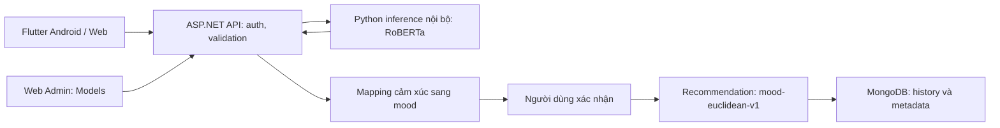

# Kiểm kê AI và phương án tích hợp Moodify

> Tài liệu lưu bằng chứng theo thời điểm, không mô tả trạng thái runtime hiện tại. Cách chạy mới nhất ở [README](../README.md); chức năng và giới hạn tổng hợp ở [báo cáo tuần 7–8](BAO_CAO_TUAN_7_8.md).

Ngày kiểm tra: 05/10/2026. Phạm vi: `code-train/train-KLCN`, notebook, backend API, Flutter Android/Web và Web Admin. Đây là báo cáo kiểm tra tĩnh và kế hoạch, chưa phải kết quả triển khai AI.

## 1. Kết luận và quyết định đề xuất

**Giữ mô hình RoBERTa-large đã fine-tune làm baseline nhận diện cảm xúc tiếng Anh, triển khai thử qua một dịch vụ Python nội bộ và đi qua API .NET. Không nhúng weights vào Flutter, Web Admin hay MongoDB.** Giữ bộ gợi ý `mood-euclidean-v1` hiện có: NLP nhận diện cảm xúc; bước ánh xạ chọn mood; bộ gợi ý mới chọn phim/nhạc. Đây là ba bước riêng.

Mô hình đủ artifact để bắt đầu thử nghiệm inference, nhưng chưa đủ bằng chứng để khẳng định chạy tốt trên máy hiện tại hoặc nhận diện đúng tiếng Việt. Chưa chạy inference, chưa đo RAM/VRAM/độ trễ, chưa tái lập metrics. Không thể bảo đảm chất lượng AI “100%”. Những kết luận về file trùng được kiểm chứng riêng bằng SHA-256, không dựa vào tên file.

Ưu tiên giai đoạn đầu: chế độ tiếng Anh thử nghiệm có xác nhận; tiếng Việt tiếp tục chọn tay/keyword với nguồn rõ ràng. Sau đó mới đánh giá mô hình tiếng Việt/đa ngôn ngữ hoặc dịch Việt–Anh. Không tự dịch bằng dịch vụ ngoài trong giai đoạn đầu, không công bố tiếng Việt đã được hỗ trợ bởi model này.

## 2. Đã đọc và đã kiểm chứng

- Notebook thực tế ở `code-train/train-KLCN/RoBERTa_large.ipynb`, không nằm ngoài `code-train` trong bản workspace đã kiểm tra.
- Danh mục đầy đủ và số byte: AI_ARTIFACT_MANIFEST.json — `AI_ARTIFACT_MANIFEST.json` (bằng chứng local đã chuyển sang archive; xem REPOSITORY_CLEANUP.md).
- Đọc code notebook, cấu hình, metrics, code deployment, header CSV; đọc header safetensors, không nạp tensor vào framework.
- So sánh mọi file trong ba ZIP với bản giải nén bằng SHA-256: **16/16 file giống nhau** tại thời điểm kiểm tra. Kết quả: AI_ARCHIVE_VERIFICATION.json — `AI_ARCHIVE_VERIFICATION.json` (bằng chứng local đã chuyển sang archive; xem REPOSITORY_CLEANUP.md).
- Đối chiếu hai Word ở thư mục gốc: đề cương `5_CNTT-KLCN318_Gợi ý phim_nhạc theo tâm trạng_UngDung.docx` và `BaoCao.docx`, các đoạn NLP, dữ liệu, gợi ý và quản lý mô hình.
- Đối chiếu `backend/Controllers/ModelsController.cs`, `RecommendationController.cs`, DTO, `admin-web/src/management.js`, quyền đăng nhập tại `main.js`, analyzer và screen khám phá Flutter.

Chưa kiểm tra: inference thực tế, toàn bộ tính hợp lệ từng hàng CSV, độ phủ ID dataset so với MongoDB hiện hành, giấy phép/nguồn thu thập từng CSV Spotify, nội dung mọi tensor. Không sửa hay xóa dataset/model; không sửa DB và không chạy notebook.

## 3. Artifact thực sự có gì?

| Nhóm | Dung lượng xấp xỉ (MiB) | Nội dung và vai trò |
|---|---:|---|
| `best_model/` | 1360,35 | Model phân loại 28 cảm xúc, tokenizer, cấu hình inference và đánh giá |
| `english_emotion_deploy.zip` | 1235,66 | Bản đóng gói trùng toàn bộ `best_model/` và `deployment/` |
| `deployment/` | <0,01 | `predictor.py`, FastAPI `api.py`, requirements |
| `goemotions/` | 5,75 | Train/dev/test TSV, thứ tự nhãn, ZIP train trùng |
| `log/roberta_large_asl_en_01/` | 0,76 | Metrics, thresholds, prediction arrays, curves, lịch sử, TensorBoard |
| `movielens/` | 3,81 | movies, ratings, links, tags; ZIP ratings trùng |
| `spotify/` | 41,90 | 45 CSV metadata/audio features/playlist/chart/kết quả dự đoán |
| Notebook | 0,21 | Code huấn luyện, đánh giá, xuất model và mã nguồn runtime nhúng |

### Model

- Run `roberta_large_asl_en_01`; base `FacebookAI/roberta-large`; kiến trúc `RobertaForSequenceClassification`.
- Weights `model.safetensors`: **1.421.602.016 byte**, F32; classifier có shape `[28, 1024]`; embedding `[50265, 1024]`. Đây là classification head 28 nhãn, không phải head regression Valence/Arousal.
- Multi-label, sigmoid, loss ASL; max input **128 model tokens**, không phải 128 ký tự.
- Notebook cấu hình seed 42, tối đa 6 epoch, learning rate 1e-5, batch 2, tích lũy 16; có chọn checkpoint bằng validation, hiệu chỉnh ngưỡng bằng calibration, early stopping. Không suy ra số epoch thực chạy chỉ từ cấu hình này.
- Sau xử lý trùng văn bản theo log: train 43.252, validation 5.414 (selection/calibration mỗi phần 2.707), test 5.427.
- Trong thư mục được cung cấp không thấy `checkpoints/` hay optimizer/scheduler state. Có thể fine-tune tiếp từ best weights, **không hứa resume chính xác trạng thái optimizer của run cũ**.
- Notebook lưu các module trong biến `SOURCES`; muốn tái lập cần xuất module này theo notebook, không coi ba file deployment là toàn bộ code training.

### Chất lượng: báo đúng ý nghĩa chỉ số

Nguồn: `log/roberta_large_asl_en_01/test_metrics.json`, đồng thời được xuất vào `best_model/evaluation_summary.json`.

| Chỉ số test tiếng Anh | Giá trị |
|---|---:|
| Micro-F1 | 59,32% |
| Macro-F1 | 53,06% |
| Exact match | 41,46% |
| Top-1 hit rate trên toàn test | 62,06% |
| Top-1 precision trong nhóm được chấp nhận | 83,55% |
| Coverage nhóm chấp nhận | 39,21% (2.128/5.427) |
| Cận dưới Wilson 95% của nhóm chấp nhận | 81,92% |

Ngưỡng chấp nhận top-1 là khoảng **0,955**; ngưỡng từng nhãn là một bảng riêng, không được thay tất cả bằng 0,5. `primary_goal_met=false`, `selective_goal_met=true`, `all_five_above_80=false`. `score` là sigmoid chưa hiệu chỉnh xác suất, **không phải % chính xác cho một câu**.

Report ghi `test_status=previously_seen_benchmark`: không gọi đây là đánh giá mù mới, không dùng test tiếp để lựa ngưỡng. Phải có tập kiểm thử độc lập cho ngữ cảnh người dùng Moodify. `language_evaluated=en`, `va_regression_evaluated=false`.

## 4. Mức phù hợp với đề cương và báo cáo

| Yêu cầu | Phần có thể dùng | Phần còn thiếu |
|---|---|---|
| Nhập câu mô tả, nhận diện cảm xúc | RoBERTa classifier 28 nhãn | Kiểm thử domain Moodify; tiếng Việt; API gateway |
| Chọn nhanh emoji | Luồng mobile hiện có | Giữ nguyên, không gắn nhãn AI cho lựa chọn tay |
| Ánh xạ cảm xúc sang mood | Có danh sách mood và VA của ứng dụng | Bảng ánh xạ có phiên bản và xử lý nhãn không tương ứng |
| Gợi ý phim/nhạc | Matching khoảng cách VA hiện có | Chưa phải collaborative/hybrid được huấn luyện |
| Quản trị/kỹ sư quản lý model | Tab Models và role backend | Registry, trạng thái runtime, test, kích hoạt/rollback |
| MovieLens/Spotify phục vụ gợi ý | Có CSV nghiên cứu | Join ID, kiểm tra chất lượng, tương tác thật, đánh giá offline |

**Điểm cần cập nhật báo cáo lý thuyết:** tài liệu mô tả DistilBERT là mô hình thử nghiệm; artifact thực tế là RoBERTa-large. Nếu chọn dùng artifact này, báo cáo triển khai phải ghi đúng RoBERTa-large và giải thích thay đổi; giữ DistilBERT ở phần nghiên cứu/so sánh, không đổi tên model để khớp báo cáo. Đề cương nhắc Spotify Million Playlist nhưng thư mục hiện có là CSV playlist/chart/audio features: không đủ bằng chứng gọi đây là bộ Million Playlist Dataset.

## 5. Dữ liệu MovieLens và Spotify nên dùng thế nào?

### MovieLens

Giữ `movies.csv`, `links.csv`, `ratings.csv`, `tags.csv` làm dữ liệu nghiên cứu recommender. `links.csv` nối movieId với imdbId/tmdbId; cần chuẩn hóa IMDb có tiền tố `tt` và giữ số 0 đầu. Không nhập trực tiếp movieId vào `NoiDungID` của Moodify; userId của MovieLens không phải tài khoản Moodify. Nếu thử collaborative filtering, dùng namespace/dataset riêng, split đánh giá riêng và giải quyết cold start. Không có checkpoint CF trong bộ artifact này.

### Spotify

Các `*_tracks_data.csv`, `artist_tracks_data.csv`, `spotify_daily_charts_tracks.csv` có các cột như valence, energy, tempo, danceability; hữu ích cho nghiên cứu nội dung nhạc, **không phải audio raw**. Các CSV playlist metadata, membership và tracks_data có cấu trúc khác nhau; không được kết luận trùng chỉ vì tên gần nhau.

`seed_track.csv`, `spotify_daily_charts_tracks_rec_pool.csv` có `predicted_genre*`; `recommendations.csv` có khoảng cách Euclidean/Manhattan/cosine. Đây là output CSV, **không thấy weights/pipeline của model phân loại thể loại tương ứng**. Không dùng nhãn predicted làm ground truth.

Trước sử dụng: kiểm tra số hàng, null, duplicate theo track_id và playlist_id, min/max đặc trưng, đơn vị duration/duration_ms, cột index rỗng, provenance và quyền sử dụng. Join bằng Spotify track ID chính xác với thư viện đang có, không join theo tên. Kiểm kê lần này chưa thực hiện join MongoDB.

Không mặc định `energy = arousal`. Nếu thử `v=2*valence-1`, đây chỉ là đổi thang khi đã xác minh input [0,1]; còn `a=2*energy-1` chỉ là **proxy thử nghiệm cần đánh giá**, không phải VA đã được đo. Không ghi đè mood admin đã duyệt, không nhập hàng loạt dữ liệu này trong giai đoạn NLP.

## 6. Kiến trúc đề xuất

Một process/worker model lúc đầu để tránh nhân đôi RAM; CPU hoặc GPU phải benchmark. Không chạy training cùng emulator. Lưu weights trên filesystem riêng, MongoDB chỉ lưu metadata phiên bản/hash/trạng thái/mapping. Model artifact không đi vào APK/bundle web hay static wwwroot. Không bật `--reload` ở vận hành, không tải model lại mỗi request.

### Hạn chế của deployment sẵn có

`predictor.py` giữ đúng nhãn và ngưỡng, dùng `eval()`/`inference_mode()`, trả candidates và yêu cầu xác nhận. Có thể tái sử dụng làm nền.

Cần hoàn thiện: `MODEL_DIR` mặc định phụ thuộc working directory; requirements còn khoảng phiên bản rộng; chưa language validation (response luôn ghi en), chưa gateway/auth/rate limit/readiness đầy đủ; chưa registry/activation. API khóa inference bằng Lock nhưng không có hàng đợi hữu hạn/timeout tổng. Tokenizer kiểm độ dài trước khi inference, trả 422 nếu quá 128 token; giữ quy tắc này hoặc thay đổi có kiểm thử rõ ràng. Notebook từng báo dependency conflict Colab: tạo venv sạch, không sao chép cả pip freeze vào server một cách máy móc.

### Tiếng Việt

Giai đoạn đầu cho người dùng chọn ngôn ngữ mô tả, mặc định tiếng Việt của ứng dụng đi theo manual/rule_based. Không dùng “có dấu/không dấu” làm bộ nhận diện ngôn ngữ. Văn bản không dấu và trộn ngôn ngữ cần fallback hoặc xác nhận ngôn ngữ. Chế độ English AI phải ghi rõ là thử nghiệm, luôn cho chỉnh mood.

Giai đoạn sau lập tập câu tiếng Việt có nhãn đúng domain, phủ phủ định, mỉa mai, nhiều cảm xúc, tiếng lóng và không dấu. So sánh baseline keyword, dịch + model Anh, và model đa ngôn ngữ/tiếng Việt fine-tune. Chưa chọn nhà cung cấp dịch hay tải model mới; độ chính xác tiếng Anh không chuyển nguyên sang tiếng Việt.

### Mapping 28 nhãn → mood

Dùng mood ID thật từ API/DB, không hardcode ID giả. Đề xuất khởi đầu cần duyệt: joy/amusement → Happy; excitement → Excited; sadness/grief → Sad; love → Romantic; relief → Relaxed (chỉ là xấp xỉ). Các nhãn còn lại không có ánh xạ chắc chắn thì trả candidates và chọn tay. Không suy `curiosity=Focused`, `neutral=Relaxed`, `remorse=Nostalgic`, hay anger/fear=Sad chỉ để lấp đủ nhãn.

Bảng mapping phải khai báo đủ 28 nhãn: mỗi nhãn có moodId hợp lệ hoặc trạng thái unmapped. Giá trị VA trong giai đoạn đầu lấy midpoint mood đã được xác nhận, **không gọi là VA model dự đoán**. Neutral, unmapped, cảm xúc đối lập hoặc người dùng đổi mood đều có luồng xử lý rõ ràng. Giữ xác nhận ngay cả khi policy tiếng Anh accepted, vì ánh xạ/domain chưa được đánh giá.

## 7. Giữ / bỏ để tiết kiệm dung lượng

### Giữ tại nơi chạy

Giữ toàn bộ `output/roberta_large_asl_en_01/best_model/` và `deployment/`. Đặc biệt không bỏ weights, tokenizer, config, inference_config/ngưỡng, evaluation_summary và run_config. `training_args.bin` không cần cho predictor nhưng chỉ ~6 KB, nên giữ cùng artifact để tránh mất metadata; không load pickle này từ upload không tin cậy.

### Giữ để bảo vệ kết quả đồ án

Giữ notebook, GoEmotions TSV + emotions.txt, log/metrics/thresholds/predictions, run_config. Tổng nhỏ so với weights. Giữ MovieLens và Spotify trong kho nghiên cứu hoặc bản sao ngoài máy; **không cần đóng gói vào service inference**. Các file log không phải gánh nặng dung lượng đáng kể.

### Có thể bỏ bản ZIP trùng sau khi giữ bản giải nén và một bản sao dự phòng

| Đường dẫn tương đối dưới `code-train/train-KLCN/` | Byte giải phóng |
|---|---:|
| `output/roberta_large_asl_en_01/english_emotion_deploy.zip` | 1.295.684.858 |
| `goemotions/train.tsv.zip` | 1.633.390 |
| `movielens/ratings.csv.zip` | 696.323 |
| **Tổng** | **1.298.014.571 byte ≈ 1,21 GiB** |

Đã kiểm tra nội dung ZIP khớp SHA-256 bản giải nén, bao gồm model weights. Kết luận an toàn ở đây là **xóa ZIP không làm mất nội dung duy nhất khi bản giải nén vẫn còn nguyên**; không có nghĩa không cần backup. Nếu muốn giữ ZIP làm bản vận chuyển, chuyển ZIP sang ổ/kho khác thay vì xóa bản duy nhất dự phòng. Chưa thực hiện xóa.

Không xóa hàng loạt Spotify/MovieLens nếu còn định làm hybrid; không xóa best_model vì đã có ZIP rồi lại xóa ZIP. Không có checkpoint optimizer lớn nào trong cây đã kiểm kê để dọn thêm. Trước xóa về sau nên đối chiếu lại manifest nếu file đã thay đổi.

## 8. Những phần chưa thể công bố hoàn thành

- NLP tiếng Việt, VA regression, recommender hybrid/CF, reinforcement learning và training tự động.
- API inference vận hành thực tế, model registry và rollback, kiểm thử tải/độ trễ, chất lượng trên câu người dùng.
- Dịch vụ hiện có artifact triển khai không đồng nghĩa đã tích hợp vào mobile/Admin.
- Chưa có bằng chứng model này nhận diện thể loại bài hát từ âm thanh hay cảm xúc từ poster/phim.

## 9. Nguồn và cách bàn giao

Số liệu model trong báo cáo lấy từ file cục bộ nêu trên, chưa tái chạy. Đối chiếu nền tảng tiếng Anh với [model card RoBERTa-large](https://huggingface.co/FacebookAI/roberta-large); dataset/nhãn với [GoEmotions chính thức](https://github.com/google-research/google-research/tree/master/goemotions); nguồn MovieLens tham khảo [GroupLens](https://grouplens.org/datasets/movielens/latest/). Không suy rằng tất cả CSV cục bộ có nguồn/giấy phép đã được xác minh chỉ từ tên thư mục.

Tích hợp đã có; xem [AI_IMPLEMENTATION.md](AI_IMPLEMENTATION.md), [artifact guide](../code-train/README.md) và [README](../README.md) để vận hành. Các nhận xét chưa triển khai trong báo cáo này là snapshot lúc kiểm kê artifact, không phải trạng thái hiện tại.
