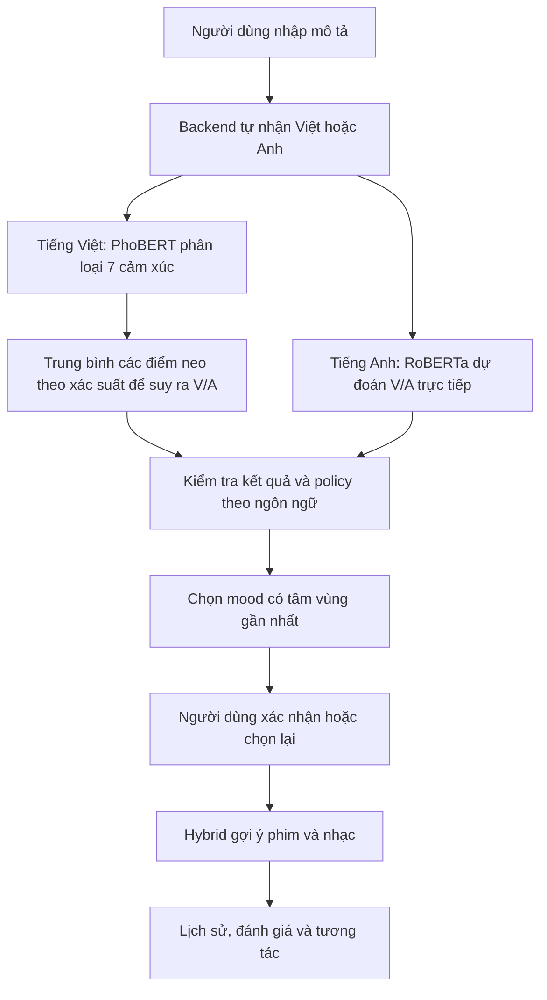

# Mapping và gán nhãn AI hiện tại trong Moodify

> **Bản cập nhật v3 — 30/10/2026:** Đã sửa xử lý phủ định và rà 136 câu/nhóm luồng. [Kết quả mới, phạm vi và giới hạn](AI_FLOW_AUDIT_2026-10-30.md). Các số liệu bên dưới là snapshot trước v3.

> **Cập nhật 30/10/2026:** Luồng chọn mood đã được sửa bằng `context-mapping-v2`. [Chi tiết triển khai và kiểm thử sau sửa](AI_MOOD_MAPPING_FIX_2026-10-30.md). Nội dung bên dưới giữ lại snapshot trước sửa.

Ngày đối chiếu: **27/10/2026**. Nội dung mô tả code và snapshot dữ liệu đã kiểm tra trong project; không phải đề xuất thay model hoặc kết luận chất lượng mới.

**Hệ thống đã có mapping tiếng Việt và tiếng Anh đang phục vụ Mobile/Web. Công cụ gán nhãn độc lập cũng đã có, nhưng bộ nhãn chuẩn mới chưa được hoàn tất.** Việc gán nhãn giúp kiểm chứng và cải thiện mapping; không tự thay mapping chỉ bằng thao tác lưu file.

## 1. Các loại nhãn và mapping cần phân biệt

| Thành phần | Ý nghĩa | Ví dụ / phạm vi |
| --- | --- | --- |
| Nhãn cảm xúc `emotion` | Lớp cảm xúc mà PhoBERT được huấn luyện phân loại | `Enjoyment`, `Sadness`, `Fear`; tổng cộng 7 lớp VSMEC |
| Tọa độ `valence`, `arousal` | Mức dễ chịu/tích cực và mức kích hoạt/năng lượng, mỗi trục từ −1 đến +1 | Bình yên có thể dễ chịu nhưng ít kích hoạt; giận có thể khó chịu nhưng kích hoạt cao |
| Nhãn ứng dụng `moodId` | Tâm trạng trong catalog Moodify, dùng để xác nhận và nhận gợi ý | Happy, Sad, Relaxed, Excited, Focused, Romantic, Nostalgic |
| Mapping NLP → mood | Chuyển kết quả phân tích văn bản thành một mood trong database | V/A → mood có tâm vùng gần nhất trong tập được policy cho phép |
| Nhãn/V/A nội dung | Thuộc tính của phim hoặc bài hát, dùng trong xếp hạng gợi ý | Tọa độ nội dung và `reviewStatus`; khác với V/A của mô tả người dùng |
| Gold label | Nhãn do người hiểu ngôn ngữ gán và review độc lập để làm đáp án đánh giá | Không lấy chính dự đoán của model làm đáp án |
| Sao/nhận xét | Phản hồi về phim/nhạc và trải nghiệm gợi ý | Dùng cho feedback/recommender, không tự trở thành nhãn cảm xúc |

Có 7 lớp VSMEC và 7 mood ứng dụng **không có nghĩa là hai danh sách tương ứng một-một**. Ví dụ `Other` không đồng nghĩa với `Relaxed`.

## 2. Luồng thực tế trên Mobile/Web



Endpoint chung là `POST /api/MoodAnalysis/valence-arousal`, Mobile dùng `language=auto`. Backend quyết định ngôn ngữ và gọi đúng model; không âm thầm chuyển sang model ngôn ngữ khác khi model cần dùng bị lỗi.

Các version được xác minh trong lượt chạy gần nhất:

| Ngôn ngữ | Version model | Đầu ra chính |
| --- | --- | --- |
| Việt | `phobert_vsmec_v2` | 7 xác suất cảm xúc, nhãn cao nhất, confidence; V/A suy ra bằng adapter |
| Anh | `roberta_va_regression_v2` | Hai tọa độ V/A từ regression |

Tên version active có thể thay đổi qua workflow triển khai. Khi vận hành phải xem runtime/lifecycle hiện tại; không suy ra model đang chạy chỉ từ tên thư mục.

## 3. Mapping tiếng Việt đang dùng

### 3.1. Bảy nhãn và điểm neo V/A

Bảng sau được đọc trực tiếp từ `VietnameseEmotionPredictor.LABELS` và `VA_ANCHORS`:

| Thứ tự | Nhãn model | Diễn giải tiếng Việt | Valence neo | Arousal neo |
| --- | --- | --- | ---: | ---: |
| 0 | `Anger` | Giận dữ | −0,80 | +0,80 |
| 1 | `Disgust` | Ghê tởm / phản cảm | −0,60 | +0,40 |
| 2 | `Enjoyment` | Vui thích | +0,80 | +0,70 |
| 3 | `Fear` | Sợ / lo sợ | −0,70 | +0,90 |
| 4 | `Other` | Không thuộc rõ sáu lớp còn lại | 0,00 | 0,00 |
| 5 | `Sadness` | Buồn | −0,80 | −0,60 |
| 6 | `Surprise` | Ngạc nhiên | +0,50 | +0,90 |

Đây là **cấu hình điểm neo cố định trong adapter**, không phải bảy tọa độ được PhoBERT học trực tiếp từ nhãn V/A. Thứ tự nhãn phải khớp `config.json`; loader kiểm tra trước khi phục vụ.

### 3.2. Cách tính V/A

Model trả xác suất của cả 7 lớp. Hệ thống dùng toàn bộ phân bố:

```text
V = tổng [xác suất lớp i × Valence neo của lớp i]
A = tổng [xác suất lớp i × Arousal neo của lớp i]
```

Nhãn cảm xúc hiển thị là lớp có xác suất cao nhất. V/A không chỉ lấy điểm neo của lớp cao nhất.

Ví dụ số học minh họa, không phải kết quả đo model: nếu chỉ có `Enjoyment=0,8` và `Sadness=0,2`, ta có `V=0,48`, `A=0,44`. Mood cuối cùng còn phụ thuộc vùng mood trong database và policy đang active.

### 3.3. Ngưỡng chấp nhận

Trong artifact `phobert_vsmec_v2` đã kiểm tra, file `confidence_threshold.json` đặt threshold khoảng **0,755964**.

Điều kiện tiếng Việt gồm:

1. Model cho phép selective prediction và confidence đạt ngưỡng của artifact.
2. Confidence đạt thêm `minimumConfidence` trong policy song ngữ đang active.
3. Kết quả, V/A và cấu hình mood hợp lệ.

Policy có thể siết thêm ngưỡng; không hạ được ngưỡng đã áp dụng trong model bằng cách nhập số nhỏ hơn ở dashboard.

Confidence là xác suất softmax của lớp đứng đầu, **không phải độ chính xác của model trên người dùng**. Ví dụ confidence 0,8 không chứng minh 80% người dùng được phân tích đúng.

Dưới ngưỡng, API trả `unknown`, không có mood đã chấp nhận hoặc `analysisId` hợp lệ. Người dùng có thể diễn đạt lại hoặc chọn mood thủ công.

### 3.4. Hạn chế đã biết

Các điểm neo hiện tại đều thỏa `A >= 0,75 × V`. Trung bình theo xác suất cũng giữ tính chất này, nên adapter không biểu diễn được tọa độ **V dương, A âm**: dễ chịu nhưng ít năng lượng.

Vì vậy, các câu bình yên/thư giãn có thể bị biểu diễn V/A chưa phù hợp. Điều này không có nghĩa mood Relaxed bị xóa khỏi hệ thống; thuật toán chọn tâm gần nhất vẫn có thể chọn nó, nhưng tọa độ suy ra và chất lượng lựa chọn cần được đánh giá.

Không sửa bằng cách tự đổi tên `Other` thành Relaxed hoặc chỉnh vài điểm neo rồi tuyên bố model đã học được mood mới. Muốn thay adapter phải có validation/test độc lập và quản lý phiên bản.

## 4. Mapping tiếng Anh và bước chọn mood chung

Tiếng Anh dùng RoBERTa regression, dự đoán V/A trực tiếp. Không đi qua 7 nhãn VSMEC hoặc bảng neo PhoBERT. API không tạo confidence phân loại giả cho regression; việc chấp nhận kết quả hợp lệ cũng không tự chứng minh dự đoán chính xác.

Cả hai ngôn ngữ dùng bước chọn mood:

```text
tâm V của mood = (minValence + maxValence) / 2
tâm A của mood = (minArousal + maxArousal) / 2

khoảng cách bình phương =
    (V dự đoán − tâm V của mood)²
  + (A dự đoán − tâm A của mood)²
```

Chọn mood có khoảng cách nhỏ nhất trong tập policy cho phép. Nếu bằng nhau, ưu tiên ID mood nhỏ hơn; API có thể trả tối đa 3 mood ứng viên.

**Thuật toán hiện tại so khoảng cách tới tâm vùng**, không bắt buộc điểm dự đoán phải nằm trong hình chữ nhật của mood. Chưa có gate từ chối riêng chỉ vì điểm cách quá xa mọi tâm mood.

Snapshot vùng mood ngày 27/10/2026:

| ID | Mood trong DB | Hiển thị tiếng Việt | Khoảng V | Khoảng A | Tâm V/A |
| --- | --- | --- | --- | --- | --- |
| 1 | Happy | Vui vẻ | 0,5 → 1 | 0,2 → 1 | 0,75 / 0,60 |
| 2 | Sad | Buồn | −1 → −0,2 | −1 → 0,2 | −0,60 / −0,40 |
| 3 | Relaxed | Thư giãn | 0,1 → 0,8 | −1 → 0,1 | 0,45 / −0,45 |
| 4 | Excited | Hào hứng | 0,4 → 1 | 0,5 → 1 | 0,70 / 0,75 |
| 5 | Focused | Tập trung | 0 → 0,6 | 0,2 → 0,8 | 0,30 / 0,50 |
| 6 | Romantic | Lãng mạn | 0,3 → 1 | −0,2 → 0,5 | 0,65 / 0,15 |
| 7 | Nostalgic | Hoài niệm | −0,3 → 0,5 | −0,5 → 0,3 | 0,10 / −0,10 |

Các ID trong công cụ gán nhãn đang theo snapshot này. Nếu đổi catalog/vùng mood, cần đối chiếu lại dữ liệu đánh giá và policy; không tự gán lại ý nghĩa cho ID cũ.

## 5. Dashboard đang quản lý được gì?

Trong dashboard AI Engineer, tab **GoEmotions mapping** có phần riêng **Bilingual VA policies**:

| Thao tác | Tác dụng thực tế |
| --- | --- |
| Chọn `vi` hoặc `en` | Tạo policy cho đúng pipeline ngôn ngữ |
| Chọn các mood ID | Giới hạn các mood mà mapper được phép chọn |
| Nhập `minimumConfidence` cho VI | Siết thêm điều kiện chấp nhận PhoBERT |
| EN để confidence bằng 0 | Regression không có confidence phân loại |
| Save candidate → Approve | Tạo và kích hoạt policy có version/revision, lý do và audit |
| Restore baseline | Khôi phục policy dùng các mood hiện tại; vẫn tăng version để receipt cũ không tự hợp lệ trở lại |

Phần này **không phải giao diện sửa bảng điểm neo**, không train model và không gán sẵn đáp án cho câu tiếng Việt.

Baseline trong code:

- VI: `vsmec-anchors-v1-nearest-center-v1`.
- EN: `regression-nearest-center-v1`.

Nếu đã approve policy riêng, `mappingVersion` là version policy đó. State lưu ở `aiBilingualPolicyState`, các candidate lưu ở `aiBilingualPolicies`.

### Bảng 28 nhãn GoEmotions khác ở đâu?

Phần **Approve emotion-to-mood mapping** với `admiration`, `joy`, `love`… thuộc classifier GoEmotions cũ. Nó không điều khiển 7 nhãn VSMEC, điểm neo PhoBERT hoặc đầu ra RoBERTa VA của app song ngữ.

Một dòng GoEmotions đang `Unmapped` không đồng nghĩa mapping tiếng Việt chưa được nối. Phải kiểm tra đúng pipeline và `modelVersion`/`mappingVersion` trong response.

## 6. Gán nhãn độc lập hiện có

Công cụ: [ai-label-review.html](../tools/ai-label-review.html).

File bắt đầu: [review-starter.json](ai-evaluation/review-starter.json).

Mẫu có **48 câu, 24 cặp Việt/Anh**, tất cả chưa review, do AI soạn để tập quy trình. Chưa phải bộ gold độc lập đủ nghiệm thu. Cặp cùng tình huống nằm cùng split validation/test.

| Trường | Tiếng Việt | Tiếng Anh | Mục đích |
| --- | --- | --- | --- |
| `emotion` | Bắt buộc để xác nhận reviewed; chọn 1 trong 7 nhãn VSMEC | Không yêu cầu; công cụ để null | Đánh giá classifier PhoBERT |
| `valence`, `arousal` | Tùy chọn; điền thì phải điền cả hai | Bắt buộc để xác nhận reviewed | Đánh giá V/A; đặc biệt hữu ích để phát hiện giới hạn adapter Việt |
| `moodId` | Tùy chọn | Tùy chọn | Đánh giá mood cuối cùng có khớp nhận định người review |
| `annotatorId` | Bắt buộc khi review | Bắt buộc khi review | Truy nguyên người gán nhãn |
| `notes` | Ghi lý do/bất đồng/chưa chắc | Tương tự | Hỗ trợ rà soát |
| `reviewed` | Chỉ chọn sau khi đọc và xác nhận | Tương tự | Xác nhận thủ công, không phải bằng chứng tự động rằng nhãn đúng |

Công cụ không gọi model để điền đáp án. Người thứ hai cần gán từ bản gốc chưa có nhãn, sau đó rà soát bất đồng. Các file hoàn tất lưu tại `docs/ai-evaluation/completed/`, đã gitignore.

File xuất từ công cụ chứa cả Việt và Anh và có thể còn câu chưa review; **không tự đủ điều kiện import thẳng làm một dataset evaluation đã hoàn tất**. Cần rà soát, tách theo task/ngôn ngữ và giữ provenance trước khi đăng ký dataset.

Hướng dẫn thao tác từng bước: [HUONG_DAN_GAN_NHAN_AI.md](HUONG_DAN_GAN_NHAN_AI.md).

## 7. Nhãn của phim/nhạc và phản hồi người dùng

Mapping văn bản sang mood khác với gán thuộc tính phim/nhạc:

- Văn bản mô tả trạng thái hiện tại của người dùng.
- Nội dung có V/A, metadata và trạng thái review riêng; Hybrid kết hợp mood, thuộc tính sở thích và collaborative score để xếp hạng.
- Vùng mood trong catalog là cấu hình của ứng dụng, không phải nhãn cảm xúc của từng câu hoặc tọa độ của từng bộ phim/bài hát.
- Sao 1–5 và tương tác giúp cập nhật hồ sơ/gợi ý lần sau; không tự chứng minh người dùng đã xem/nghe hết hoặc biến nhận xét thành gold NLP.

Snapshot catalog đã kiểm tra có 117 nội dung: 60 phim, 57 bài hát; `reviewStatus` gồm 112 pending và 5 reviewed. Đây là mốc kiểm kê, không chứng minh toàn bộ V/A nội dung đã được người phụ trách xác nhận.

## 8. Gán nhãn xong có tự thay hệ thống không?

**Không.** Lưu/export nhãn là bước chuẩn bị dữ liệu. Quy trình tiếp theo:

1. Review độc lập, xử lý bất đồng và kiểm tra trùng/leakage.
2. Tách emotion, VA và mood; giữ split và nguồn dữ liệu. Không lấy dự đoán model làm đáp án.
3. Chốt protocol/quality policy trước evaluation job; dùng validation để chọn ứng viên, giữ test riêng.
4. Chạy baseline và candidate nguyên trạng bằng evaluation-only runner; đo macro-F1/coverage/selective accuracy cho VI, MAE/RMSE cho VA, và mood match khi có gold mood.
5. Review báo cáo và quyết định giữ hoặc thay model/adapter/policy.
6. Thay model qua workflow approval/Activate có fingerprint. Thay policy mapping dùng workflow candidate/Approve riêng; hiện chưa có gate metric tự động tương đương gate model trên mọi thao tác đổi policy.

Quality gate model kiểm tra báo cáo do kỹ sư nộp và danh tính artifact; không tự chứng minh chất lượng/độc lập của nhãn. Xem [protocol đánh giá](AI_EVALUATION_PROTOCOL.md) và [hướng dẫn AI Engineer](AI_ENGINEER_IMPLEMENTATION.md).

Khi kết quả AI được chấp nhận, server cấp `analysisId` gắn account, hạn 5 phút. Khi xác nhận, server kiểm tra lại model, policy và cấu hình mood; đổi policy/vùng mood có thể làm kết quả cũ hết hợp lệ. Người dùng phải phân tích lại, không dùng response cũ để giả nguồn AI.

## 9. Trạng thái hiện tại và phần còn thiếu

| Phần | Trạng thái |
| --- | --- |
| Mapping VI: xác suất VSMEC → V/A → mood | Đã triển khai và chạy qua app |
| Mapping EN: regression V/A → mood | Đã triển khai và chạy qua app |
| Policy theo ngôn ngữ, mood ID, version/revision | Đã có trên dashboard/API |
| Receipt/provenance và xác nhận phía server | Đã có |
| Công cụ gán nhãn Việt/Anh, xuất/lưu nháp | Đã có |
| Bộ gold mới hoàn tất review độc lập | Chưa có trong lượt nghiệm thu |
| Đo chất lượng mapping bằng gold mới | Chưa hoàn tất |
| Khắc phục có kiểm chứng giới hạn thư giãn/bình yên của adapter VI | Chưa hoàn tất |
| Tự học lại điểm neo chỉ từ file nhãn | Không có cơ chế tự động này |
| Preprocessing PhoBERT đúng bản export lúc train | Chưa khôi phục được; bản CSV mới vẫn là candidate |

PhoBERT hiện vẫn dùng fallback preprocessing đã công bố; hai CSV emoji/teencode mới chưa được dùng thay serving. Chi tiết và giới hạn: [PHOBERT_PREPROCESSING_AUDIT.md](PHOBERT_PREPROCESSING_AUDIT.md).

**E2E pass chứng minh luồng hoạt động; không chứng minh mapping chính xác với mọi mô tả người dùng.**

## 10. Các file quyết định hành vi

| File | Vai trò |
| --- | --- |
| [vietnamese_predictor.py](../ai-service/vietnamese_predictor.py) | 7 lớp VSMEC, bảng neo, confidence và phép tính V/A tiếng Việt |
| [va_predictor.py](../ai-service/va_predictor.py) | Dự đoán V/A tiếng Anh |
| [BilingualMoodAnalysisService.cs](../backend/Services/BilingualMoodAnalysisService.cs) | Mapper chung, chọn tâm gần nhất, hợp đồng và receipt |
| [BilingualPolicyService.cs](../backend/Services/BilingualPolicyService.cs) | Candidate/Approve/reset policy theo ngôn ngữ |
| [AiPoliciesController.cs](../backend/Controllers/AiPoliciesController.cs) | API policy dành cho AI Engineer |
| [ai-tools.js](../admin-web/src/ai-tools.js) | Công cụ policy và quality review trong dashboard |
| [ai-label-review.html](../tools/ai-label-review.html) | Gán nhãn độc lập trên máy |
| [evaluate_bilingual.py](../ai-service/evaluate_bilingual.py) | Tính chỉ số từ nhãn và dự đoán |

Đã tiếp nhận bản nhãn v2 được người dùng xác nhận và chạy 48 câu đối chiếu: [baseline ngày 27/10/2026](AI_BASELINE_PHUONG_2026-10-27.md). Đây là nhãn AI được chấp nhận để chẩn đoán; phần gold độc lập vẫn chưa hoàn tất.
