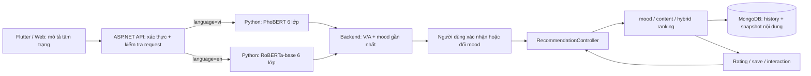

# Moodify: luồng AI và hướng dẫn chọn dataset

> **Cập nhật 01/11/2026:** Hai classifier 6 lớp mới đã được tích hợp. Mô tả PhoBERT cũ và English VA regression là thông tin lịch sử, không phải model đang hoạt động mặc định; classifier GoEmotions 28 nhãn vẫn là luồng legacy riêng.

**Mục tiêu:** mô tả luồng AI đang có trong project, phân biệt model thật với luật/heuristic, và đề xuất dữ liệu phù hợp cho các bước nghiên cứu tiếp theo.

**Phạm vi đọc:** mã nguồn `backend/`, `ai-service/`, `mobile-app/`, `admin-web/`, notebook trong `code-train/`, và tài liệu `docs/AI_*`. Đây là phân tích tĩnh từ repository; tài liệu theo ngày có thể là snapshot cũ. Không chạy model, notebook hay truy vấn MongoDB trong lúc lập tài liệu. Thư mục model weights/dataset riêng không nằm đầy đủ trong Git, do đó không thể xác nhận chúng hiện có trên máy hoặc tái tạo kết quả chỉ từ source.

## Tóm tắt nhanh

1. Người dùng nhập mô tả → API .NET gọi Python inference nội bộ: tiếng Việt dùng PhoBERT 6 lớp, tiếng Anh dùng RoBERTa-base 6 lớp; cả hai suy V/A bằng anchors.
2. Model không trực tiếp chọn phim/nhạc. Backend chọn mood gần điểm VA nhất; người dùng xác nhận/đổi mood rồi backend xếp hạng nội dung.
3. Recommendation hiện có ba mode: `mood` theo độ gần VA; `content` theo hồ sơ thể loại/đạo diễn/nghệ sĩ/album từ rating và tín hiệu mở nội dung; `hybrid` trộn mood, content và một thành phần tương đồng người dùng dựa trên rating. Đây là recommender xác định theo luật, không phải model neural được train end-to-end.
4. Nhật ký AI hiện lưu provenance/phiên bản trong lịch sử gợi ý. Rating và một số interaction cập nhật hồ sơ cho request kế tiếp; đó là feedback loop, không phải reinforcement learning.
5. Ưu tiên dataset: tạo tập câu tiếng Việt Moodify có người gán nhãn; dùng UIT-VSMEC làm baseline/transfer; giữ GoEmotions cho classifier tiếng Anh; dùng EmoBank chỉ làm baseline VA tiếng Anh; dùng MovieLens để kiểm tra phương pháp CF độc lập; dùng log Moodify đã consent để đánh giá recommender trong domain thật.

## 1. Sơ đồ xử lý



## 2. Luồng phân tích văn bản

### 2.1 Client chọn model/ngôn ngữ

- **Mobile:** màn hình Khám phá gửi `POST /api/MoodAnalysis/valence-arousal`. Bộ quy tắc nhẹ ở `mobile-app/lib/services/mood_analysis/mood_language.dart` tự chọn `vi` hoặc `en`; đây không phải model nhận diện ngôn ngữ. Câu không dấu/ngắn/pha ngôn ngữ có thể định tuyến sai.
- **Web người dùng:** chọn Việt/Anh trên form và gửi trường `language`; văn bản tiếng Việt nhưng chọn English sẽ đi model VA tiếng Anh.
- Cả hai model chạy trong Python service cục bộ, không nhúng weights vào ứng dụng. API .NET xác thực người dùng, kiểm tra kết quả và lưu provenance ở bước gợi ý.

### 2.2 Nhánh tiếng Việt: PhoBERT classifier 6 lớp

- Candidate: `phobert_moodify_6c_20261101_053022`, base `vinai/phobert-base-v2`, max length 96.
- Nhãn đọc từ artifact: `Sadness`, `Enjoyment`, `Love`, `Anger`, `Fear`, `Surprise`. Tiền xử lý emoji → dấu câu → lowercase/teencode → PyVi phải khớp notebook; từ điển teencode candidate mới là bảng curated 42 mục, không phải bảng tự suy rộng cũ.
- V/A = Σ(probability × anchor) từ `label_config.json`, không phải regression. Anchor Love=(0.8,0.3) chưa được kiểm chứng.
- Kết quả đã ghi lúc train: test dịch máy 2.000 câu 85.70% accuracy / 81.08% macro-F1; UIT-VSMEC 5 lớp, 432 câu 79.40% / 64.18%. Test tiếng Việt thật chưa đạt mục tiêu accuracy 85%; không gộp hai test.
- `accepted` ngưỡng chưa có trong artifact nên API trả null; client yêu cầu kiểm tra/xác nhận. Backend chọn nearest mood theo V/A.

### 2.3 Nhánh tiếng Anh: RoBERTa classifier 6 lớp

- Candidate: `roberta_base_moodify_6c_20261101_051915`, base `roberta-base`, max length 64.
- Route `/predict-va` được giữ cho tương thích .NET nhưng hiện model mới trả sáu nhãn và anchor-derived V/A. Legacy `.pt` regression adapter được giữ để có thể đọc candidate cũ.
- Test `dair-ai/emotion` chính thức, 2.000 câu, ghi nhận accuracy 93.25% / macro-F1 90.17%. Đây là test cùng nguồn/phân phối train, không chứng minh chất lượng trên câu Moodify.
- Ngưỡng confidence chưa được cung cấp; `accepted=null` cho đến khi hiệu chỉnh. Không coi confidence là phần trăm dự đoán đúng.

### 2.4 Classifier tiếng Anh 28 nhãn: luồng song song/di sản

- `ai-service/predictor.py` tải classifier multi-label 28 nhãn, sigmoid + ngưỡng từng nhãn, kiểm SHA-256 artifact và giới hạn 128 model token.
- Model artifact `roberta_large_asl_en_01` được fine-tune từ `FacebookAI/roberta-large` theo GoEmotions; đây là classifier cảm xúc tiếng Anh, khác cả PhoBERT Việt và RoBERTa VA.
- Luồng API classifier cũ (`POST /api/MoodAnalysis`) cùng mapping/registry cần phân biệt với luồng song ngữ VA mà Mobile đang dùng. Dashboard AIEngineer có các màn quản lý model/mapping/evaluation/inference; có mục hoặc code cũ không đồng nghĩa nó đang được gọi trong flow Mobile hiện tại.
- Score sigmoid là score chưa calibration, không phải phần trăm chính xác. Người dùng cần xác nhận mood do khác biệt giữa taxonomy cảm xúc và mood app.

## 3. Từ mood đến gợi ý và phản hồi

### 3.1 Recommendation

`backend/Controllers/RecommendationController.cs` nhận mood ID, mode, giới hạn nội dung và (với `source=ai_va`) V/A + `modelVersion`.

- **`mood`:** xếp nội dung theo khoảng cách V/A đến tâm trạng thái cảm xúc; điểm khớp quy đổi tuyến tính từ khoảng cách. Đây là content-mood matching, không cần train recommender.
- **`content`:** `HybridRecommender` tạo vector nhị phân chuẩn hóa từ thể loại, đạo diễn, nghệ sĩ, album; hồ sơ người dùng được tổng hợp từ rating gần nhất trên từng nội dung và tín hiệu mở nội dung. Xếp theo cosine-like score; nếu thiếu profile thì fallback mood.
- **`hybrid`:** cộng có trọng số mood 0.55, content 0.30, collaborative 0.15; nếu một tín hiệu không có thì chuẩn hóa theo các thành phần hiện diện. Collaborative dùng các rating user-item, tìm tối đa 20 user lân cận có tương đồng dương và ít nhất 2 item chung. Dislike rating làm giảm điểm item đó. Đây là baseline heuristic; không có checkpoint CF/pretrained recommender.
- API lưu thuật toán, VA, nguồn/model version và danh sách nội dung đã gợi ý vào history. Với analysis token, backend lưu provenance ngắn hạn, ràng buộc user, thời hạn, mapping/mood config và chống tái sử dụng request không nhất quán.
- Nội dung từ catalog ngoài chỉ được thêm khi có metadata/mood đáng tin; ID-only track không bị gán VA giả.

### 3.2 Feedback

- Rating 1–5 là tín hiệu rõ nhất. Tương tác `detail_open`, `player_loaded`, `external_open`, `trailer_open` được ghi riêng; implementation hiện dùng `external_open`/`trailer_open` như implicit positive yếu trong profile. Mở player không chứng minh nghe/xem hết.
- Hệ thống cập nhật profile ở request kế tiếp. Không có reward theo episode, policy exploration hay tối ưu online kiểu RL.
- Muốn train/evaluate recommender thực chất, cần log **impression** (đã hiển thị item, vị trí/ranking, context, phiên bản thuật toán) để phân biệt không click vì không thích với không nhìn thấy. Hiện tại interaction đơn thuần không đủ làm negative label.

## 4. Những artifact/dữ liệu đã thấy trong repo hoặc docs

| Artifact/data | Bài toán phù hợp | Hạn chế cần ghi rõ |
|---|---|---|
| GoEmotions TSV + classifier `roberta_large_asl_en_01` | Phân loại cảm xúc văn bản tiếng Anh đa nhãn; baseline/checkpoint | Reddit English không đại diện user Moodify; classifier score chưa phải accuracy; benchmark test đã từng dùng trong báo cáo, cần tập độc lập mới. |
| PhoBERT 6 lớp mới + UIT-VSMEC/English machine translation | Emotion tiếng Việt và V/A suy từ anchors | VSMEC test n=432: 79.40% accuracy / 64.18% macro-F1; test dịch máy phải báo riêng. |
| RoBERTa-base 6 lớp mới + dair-ai/emotion | Emotion tiếng Anh và V/A suy từ anchors | Test 2.000 câu: 93.25% / 90.17%; in-distribution, chưa có test Moodify độc lập. EmoBank/checkpoint VA là luồng cũ, không phải English model đang tích hợp mặc định. |
| MovieLens `movies/ratings/links/tags` | Thử nghiệm CF, ranking và pipeline join movie ID | MovieLens userID/movieID là namespace riêng; không nối thẳng sang account/content ID Moodify. Rating MovieLens không mang mood của người dùng. |
| Spotify CSV (track metadata/audio features/charts/playlists) | Phân tích metadata bài hát, thử content feature | Audio feature không phải raw audio hoặc sở thích user. `predicted_genre*` và recommendation output CSV không phải nhãn chuẩn. Xác minh nguồn, quyền sử dụng, ID, đơn vị và duplicates. |
| Mongo collections `ratings`, `interactions`, `moodHistory`, catalog | Domain thật để hiệu chỉnh/đánh giá recommender khi có consent | Cần audit lượng/độ phủ, chính sách retention, PII, impressions, bias và ID mapping trước khi tạo dataset. Không dùng backup người dùng như dữ liệu train có thể chia sẻ. |

## 5. Chọn dataset theo mục tiêu nghiên cứu

### A. Câu tiếng Việt → cảm xúc

**Khuyến nghị:** tạo một tập chuẩn Moodify do người gán nhãn, rồi dùng UIT-VSMEC để pretrain/so sánh. UIT-VSMEC có khoảng 6.927 câu tiếng Việt được gán nhãn cảm xúc; phù hợp làm benchmark/baseline, nhưng không đủ để khẳng định chất lượng trên các câu mô tả tâm trạng trong app. [Bài báo UIT-VSMEC](https://arxiv.org/abs/1911.09339), [dataset card](https://huggingface.co/datasets/tridm/UIT-VSMEC).

- Chốt taxonomy sáu lớp (`Sadness`, `Enjoyment`, `Love`, `Anger`, `Fear`, `Surprise`) và hướng dẫn nhãn rõ ràng. Model hiện không có lớp `Other`, vì vậy câu trung tính/không đủ thông tin cần được xử lý như trường hợp cần xác nhận, không tự gán thành một emotion.
- Thu thập câu tự nguyện, bỏ định danh cá nhân, bao phủ câu ngắn/dài, có dấu/không dấu, teencode, emoji, phủ định, mỉa mai, cảm xúc pha trộn và câu trung tính. Ghi riêng ngôn ngữ/kiểu viết chỉ khi cần và có consent.
- Mỗi câu nên có 2–3 annotator; lưu bất đồng, adjudication và confidence nhãn. Tách train/dev/test theo người viết hoặc phiên thu thập (nếu có ID đã ẩn danh), không random split các paraphrase gần nhau.
- UIT-VSMEC có taxonomy riêng; notebook mới gom nhãn vào sáu lớp của model Moodify. Trước khi tái huấn luyện, cần kiểm tra bảng mapping trong notebook và giữ riêng nhãn không tương ứng thay vì gán ép vào lớp khác. Không nhân bản dữ liệu hoặc tự tổng hợp nhãn để lấp lớp.

**GoEmotions:** giữ cho nhánh tiếng Anh. Dataset chính thức có 58,009 Reddit comments, 27 cảm xúc + neutral và split gốc train/dev/test; tốt cho multi-label tiếng Anh, nhưng không phù hợp làm dữ liệu Việt hoặc dữ liệu mô tả mood domain của Moodify. Dùng split gốc và tạo domain test Moodify độc lập. [Google Research paper](https://research.google/pubs/goemotions-a-dataset-of-fine-grained-emotions/), [official data README](https://github.com/google-research/google-research/blob/master/goemotions/README.md).

### B. Câu tiếng Anh → valence/arousal

**Tình trạng hiện tại:** model English mới là classifier 6 lớp; V/A được tính từ anchors. EmoBank chỉ phù hợp nghiên cứu/baseline riêng nếu tiếp tục nhánh regression, không phải model English đang được gọi mặc định. Nên bổ sung tập Moodify được gán nhãn cảm xúc; nếu cần V/A gold thì tạo/thu thập tập V/A riêng. EmoBank có khoảng 10k câu, nhãn theo góc nhìn người viết và người đọc trên Valence-Arousal-Dominance; có split khuyến nghị trong repo chính thức. Chọn một perspective làm target, giữ nguyên split và quy đổi thang điểm theo tài liệu dataset. [EmoBank official repository](https://github.com/JULIELab/EmoBank).

- Đừng gọi output VA của PhoBERT (trọng số lớp × điểm neo) là nhãn gold hoặc coi nó tương đương regression label.
- Đánh giá regression bằng MAE/RMSE/correlation riêng cho V và A; báo cáo uncertainty/inter-rater agreement. Không dùng emotion classifier F1 thay cho VA metric.
- Cân nhắc emotion phrase in context, phủ định, câu pha trộn và domain-app; split theo nguồn/người viết để tránh leakage.

### C. Tâm trạng → phim/nhạc phù hợp

**Khuyến nghị:** dùng catalog Moodify đã rà soát làm candidate universe, tự gán nhãn phù hợp mood cho một tập nhỏ chuyên gia/annotator; chấm `relevance` theo mức phù hợp với mood + lý do. Dùng đây để so sánh `mood-euclidean-v1`, thay đổi trọng số, hoặc learning-to-rank sau này. MovieLens không trả lời câu “phim nào hợp khi tôi đang buồn”.

- MovieLens hiện có trong repo hữu ích để kiểm tra riêng CF/ranking và join phim qua `links.csv`. Đặt ID namespace tách biệt, chuẩn hóa imdbId có tiền tố `tt`/giữ số 0 đầu và đối chiếu TMDB ID; không dùng MovieLens user ID thành Moodify account ID. GroupLens yêu cầu xem README/terms của đúng release; không mặc định được phép redistribute. [GroupLens datasets/terms](https://grouplens.org/datasets/movielens/).
- Spotify track features có thể hỗ trợ content similarity cho nhạc (genre, valence, energy, tempo, danceability) sau khi xác minh nguồn/đơn vị. Không giả định `energy = arousal`; proxy `2*energy-1` chỉ là giả thuyết cần đánh giá, không phải gold VA.
- Đánh giá offline bằng temporal holdout; nếu log impression, dùng Recall@K/NDCG@K/MAP@K và coverage/diversity. Relevance từ người gán nhãn cần phân tích agreement. Đánh giá user-level/temporal để tránh train trên tương lai.

### D. Học sở thích cá nhân/recommender

**Khuyến nghị dữ liệu chính:** first-party feedback có consent trên chính item đã được hiển thị.

| Field cần ghi | Ý nghĩa |
|---|---|
| `user_key` giả danh hóa | Tài khoản ẩn danh ổn định, không email/tên |
| `item_id`, `item_type`, `catalog_source` | Namespace rõ cho Movie/Track và nguồn ID |
| `recommendation_id`, `position`, `was_impressed` | Biết item có được hiển thị và ở vị trí nào |
| `mood_id`, V/A, input language, `analysis_source` | Context gợi ý; không lưu raw text mặc định |
| `action`, `rating`, `saved`, timestamp | Tách feedback explicit khỏi implicit |
| `algorithm_version`, `model_version`, `mapping_version` | Tái lập kết quả và so sánh phiên bản |

Giữ `rating` (explicit) riêng với `external_open`/`trailer_open` (weak positive), và không biến “không tương tác” thành dislike. Có thể dùng MovieLens để chạy benchmark CF, nhưng model chỉ là nghiên cứu offline; đánh giá trên interaction Moodify trước khi áp dụng. Tránh đưa raw mood description, token, email hoặc thông tin nhạy cảm vào training bundle/log.

## 6. Thiết kế nhãn và quy trình dataset gợi ý

### Nhãn câu

```text
sample_id, text, language, emotion_label, valence, arousal,
annotator_count, disagreement, source, consent_scope, split, created_at
```

- `emotion_label` và V/A là target khác nhau; một task có thể thiếu một trong hai.
- Categorical: multi-label nếu cho phép nhiều cảm xúc cùng lúc; nếu giữ single-label thì hướng dẫn chấm phải nói rõ cảm xúc trội và câu pha trộn.
- VA: dùng thang thống nhất (ví dụ [-1,1]) và lưu cả raw scale/source; trung bình annotator không xóa mất độ bất đồng.
- Dùng `sample_id` ổn định; không dùng text hash công khai để giả danh hóa user (câu ngắn dễ dò ngược).

### Split/QA tối thiểu

1. Lưu manifest: nguồn, license/terms, ngày lấy, preprocessing, số hàng, label map, hash file, annotator protocol.
2. Dò duplicate exact/near-duplicate trước split; cùng chủ đề hoặc cùng người viết không nên rò giữa train/test.
3. Giữ test set kín; chỉ dùng dev/validation để chọn checkpoint/ngưỡng. Tạo domain test Moodify mới và không tái sử dụng làm tuning.
4. Báo macro-F1, per-class precision/recall/F1, confusion matrix, coverage/selective accuracy cho classifier; MAE/RMSE/correlation cho VA.
5. Báo kết quả theo nhóm dấu/không dấu, slang, câu ngắn, emoji, phủ định/pha trộn và class imbalance; chỉ kết luận ở nhóm có đủ mẫu.
6. Ghi rõ seed, tokenizer, max length (model hiện có giới hạn 128 token ở classifier tiếng Anh), model base/checkpoint/hash, threshold calibration và cấu hình train.
7. Kiểm tra license của dataset, base model và từng artifact riêng. Một dataset truy cập được không tự động cấp quyền tái phân phối weights hoặc raw text.

## 7. Lộ trình thực tế

1. **Baseline và kiểm kê:** chốt bài toán cụ thể (emotion / VA / ranking), nhãn, model version; kiểm tra dataset, license, duplicates và class distribution.
2. **Gold set Moodify:** bắt đầu với một pilot cân bằng theo nhãn/kiểu câu; hướng dẫn annotator, đo agreement, sửa rubric rồi mới mở rộng.
3. **Đánh giá model hiện có:** test PhoBERT 6 lớp trên tiếng Việt Moodify; test RoBERTa-base 6 lớp trên English Moodify; test classifier 28 lớp trên English domain. Tách test dịch máy và test tiếng Việt thật. Không trộn ba output.
4. **Recommender offline:** so sánh mood-only baseline với content/hybrid trên impression + rating, kiểm tra cold-start và theo dõi NDCG/Recall, coverage, diversity.
5. **Train candidate riêng:** không ghi đè serving artifact; lưu data/config/base/model hashes và report. Review chất lượng, privacy và license trước khi validate/activate.

## 8. Kết luận sử dụng dataset

- **Vietnamese emotion:** UIT-VSMEC để khởi đầu; cần tạo domain set Moodify mới làm bằng chứng chính.
- **English emotion:** GoEmotions cho classifier 28 nhãn hiện có; thêm domain set độc lập.
- **English emotion:** model RoBERTa-base 6 lớp đạt 93.25%/90.17% trên in-distribution test; cần domain test Moodify mới.
- **Movie/track recommendation:** MovieLens để benchmark CF tách biệt; Spotify CSV để thử metadata content nếu quyền sử dụng cho phép; dữ liệu Moodify có impression + explicit rating mới là nguồn đánh giá domain.
- **Không nên:** dùng emotion label làm mood app trực tiếp; dùng synthetic/weak pseudo-label làm gold; coi absent click là dislike; coi preview/open là complete play; hoặc gọi feedback loop hiện tại là RL.

## 9. Mã nguồn nên đọc tiếp

| Phần | File |
|---|---|
| Route API và phân nhánh language | `backend/Controllers/MoodAnalysisController.cs` |
| Inference VA tiếng Anh, chọn mood | `backend/Services/ValenceArousalAnalysisService.cs` |
| Inference PhoBERT và chọn mood | `backend/Services/VietnameseEmotionService.cs`, `ai-service/vietnamese_predictor.py` |
| Classifier 28 nhãn | `ai-service/predictor.py`, `backend/Services/MoodAnalysisService.cs` |
| Recommendation/history/provenance | `backend/Controllers/RecommendationController.cs`, `backend/Services/MoodAnalysisService.cs` |
| Ranking feedback/content/collaborative | `backend/Services/HybridRecommender.cs`, `backend/Services/MoodScoring.cs` |
| Ghi interaction | `backend/Controllers/InteractionsController.cs`; rating ở `backend/Controllers/` |
| Mobile route và chọn ngôn ngữ | `mobile-app/lib/core/api_service.dart`, `mobile-app/lib/services/mood_analysis/mood_language.dart`, `mobile-app/lib/screens/mood_discovery_screen.dart` |
| Train/serve/documentation | `code-train/train-KLCN/`, `ai-service/README.md`, `docs/AI_TRAINING_AUDIT.md`, `docs/AI_MODEL_TEST_CASES.md`, `docs/PERSONAL_STATS_LOCAL_TRAINING.md` |

> Lưu ý tính thời điểm: tài liệu trong `docs/` có snapshot ngày khác nhau. Khi ghi báo cáo luận văn, ưu tiên trạng thái của source hiện tại và ghi rõ ngày/commit; không chép số liệu cũ như một kết quả mới.
